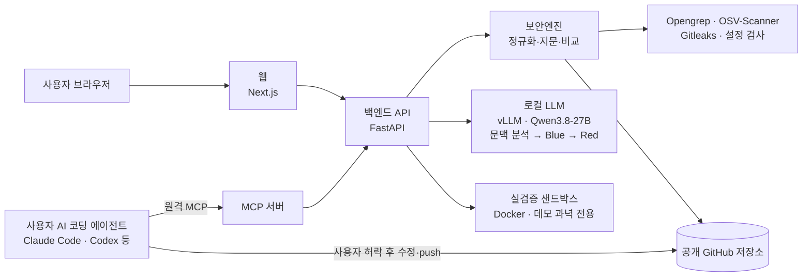

# 72hours

**찾고, 고치고, 확인까지.**
AI 코딩 도구로 서비스를 만드는 개발자를 위한 보안 점검 서비스입니다. 공개 GitHub 저장소에서 개인정보·서비스 접근 권한에 영향을 줄 수 있는 위험을 찾아 쉬운 말로 우선순위를 알려 주고, 사용자의 AI 코딩 에이전트가 고칠 수 있게 수정 지시를 넘긴 뒤 재검사로 결과를 확인합니다.

| 바로 써 보기 | 주소 |
|---|---|
| 웹 | https://oboe-handiness-enroll.ngrok-free.dev |

> 웹 이용자는 서버·모델을 설치하지 않습니다. 무료 ngrok 주소라 브라우저로 처음 들어가면 ngrok 안내 화면이 한 번 나오며, **Visit Site**를 누르면 됩니다.

---

## 문제와 해결

**누구의 문제인가.** Cursor·Claude Code·Codex 같은 AI 코딩 도구로 쇼핑몰, 예약, 커뮤니티 같은 작은 서비스를 빠르게 만들지만, 보안 검토와 "무엇부터 어떻게 고칠지" 판단에는 익숙하지 않은 개발자입니다.

| 사용자가 겪는 문제 | 72hours의 대응 | 얻는 결과 |
|---|---|---|
| AI가 만든 코드에 DB 관리자 키, 결제 키가 그대로 들어가거나 `NEXT_PUBLIC_` 변수로 브라우저에 노출됨 | Gitleaks·자체 규칙으로 찾고, "코드에서 지우기"와 "발급처에서 폐기·재발급"을 구분해 안내 | 키를 지운 뒤에도 남는 위험(깃 기록·배포본)까지 처리 |
| SQL 인젝션, 로그인 확인 없는 쓰기 API, RLS를 켜지 않은 테이블로 고객 정보가 새어 나갈 수 있음 | 바이브 코딩에서 자주 나오는 패턴 규칙과 설정 검사로 찾고, 로컬 LLM이 문맥을 보고 쉬운 말로 설명 | 비전공자도 "왜 위험한지, 무엇부터" 이해 |
| 경고는 많은데 우선순위와 수정 방법을 모름 | CISA SSVC 결정표를 코드로 적용해 지금 / 이번 주 / 지켜보기로 분류, OS별 명령은 검증된 템플릿에서만 생성 | 같은 입력이면 같은 판단, 모델이 명령을 지어내지 않음 |
| 고쳤다고 생각했는데 실제로는 안 고쳐졌거나 새 문제가 생김 | push 후 재검사해 이전 결과와 비교: 새로 생김 / 계속 있음 / 해결됨 / 확인 불가 | 도구가 실패한 것을 "해결"로 착각하지 않음 |

사고가 의심될 때는 보조 기능으로 침해사고(24시간)·개인정보 유출(72시간) 신고서 **초안**을 만듭니다. 자동 제출은 하지 않습니다.

---

## 핵심 기능

🔍 **찾기**: 공개 GitHub 주소를 넣으면 코드·비밀키·의존성·설정을 한 번에 검사합니다. Opengrep, OSV-Scanner, Gitleaks와 팀이 만든 설정 검사기의 결과를 하나의 형식으로 정규화하고, 같은 문제를 줄 번호와 무관하게 식별하는 지문을 붙입니다.

🧠 **이해하기**: 로컬 GPU의 Qwen3.8-27B가 문맥(실행 위치, 노출 범위, 다루는 데이터)을 분석합니다. Blue가 쉬운 설명과 수정 지시를 쓰고, Red가 공격자 관점에서 그 수정을 다시 검토합니다(Red–Blue). 위험도와 실행 명령은 모델이 아니라 코드가 정합니다.

🛠️ **고치기**: MCP(AI 코딩 도구에 외부 기능을 붙이는 표준)로 사용자의 AI 코딩 에이전트에 연결합니다. 에이전트는 Red 검토를 통과한 수정 지시를 받아 **사용자가 허락한 항목만** 로컬 코드에서 고칩니다. 72hours 서버는 사용자 코드를 직접 수정하지 않습니다.

✅ **확인하기**: 수정을 push한 뒤 재검사해 이전 결과와 비교합니다. 데모 과녁에서는 격리된 Docker 환경에서 고치기 전·후에 같은 공격을 실제로 실행해 차단 여부와 기능 유지까지 확인합니다. **사용자 저장소의 실행 검증은 아직 지원하지 않습니다.**

MCP 도구 15개와 클라이언트별 연결 방법: [integrations/mcp-handoff/DISTRIBUTION.md](integrations/mcp-handoff/DISTRIBUTION.md)

---

## 실제 사용 사례

### 1) 시연용 취약 저장소 점검: `maebsy/cafe-order-demo`

팀이 대회 기간에 만든, 일부러 취약하게 만든 카페 주문 사이트입니다(가짜 키·가상 데이터). 정답지(`expected-findings.json`)에 걸려야 할 것과 걸리면 안 되는 것을 미리 적어 두고 비교했습니다.

| 항목 | 값 |
|---|---|
| 대상 | `maebsy/cafe-order-demo`, 태그 `v1-vulnerable` (커밋 `4bc1458`) |
| 발견 | 25건: 코드 10 · 비밀값 3 · 설정 5 · 의존성 7 |
| 정답지 대비 | 탐지 15 / 미탐 1 / 오탐 0 / 함정 통과 2 |
| 놓친 것 | `// nosemgrep` 주석으로 숨긴 SQL 인젝션 1건 |
| 근거 | [cafe-order-demo README의 실측 결과](https://github.com/maebsy/cafe-order-demo#실측-결과-72hours-보안엔진-v1-vulnerable) |

하나의 시연용 저장소에 대한 결과이며, 일반적인 탐지율을 뜻하지 않습니다.

### 2) 수정 전·후 공격 실행 검증 (별도 데모: `demo-vulnerable-site/`)

위 사례와 **다른 저장소**인 이 저장소 안의 데모 과녁에서 실행했습니다.

| 공격 | 고치기 전 | 고친 뒤 | 판정 |
|---|---|---|---|
| SQL 인젝션 (`sqli-orders`) | 성공 | 차단 | verified |
| 반사형 XSS (`xss-search`) | 성공 | 차단 | verified |

- 기능 테스트는 고치기 전·후 각각 3건 통과했고, 격리 4항목(네트워크 차단, root 아님, 권한 제거, 권한 상승 금지)이 전·후 모두 확인됐습니다.
- 근거: 기준 수정본 모드, 2026-10-31 로컬 Docker 실행([docs/verify.md](docs/verify.md)). 운영 서버에서 MCP `verify_demo`로 실행한 결과는 [PR #141](https://github.com/maebsy/YMCA-hackathon-2026/pull/141)에 있습니다.

---

## 직접 개발한 기술과 아키텍처



| 구분 | 팀이 직접 만든 것 | 가져다 쓴 것 |
|---|---|---|
| 탐지 | 결과 정규화, 줄 번호와 무관한 지문, 재검사 비교(new/persisting/resolved/unverifiable)와 4가지 상태, 숨김 주석 탐지, 바이브 코딩 규칙(JS/TS/Python/SQL), 설정 검사기, 추천 업그레이드 버전 재조회 | Opengrep, OSV-Scanner, Gitleaks 실행 |
| 해석 | 문맥 분석·Blue·Red 프롬프트와 파이프라인, 출력 검증과 재작성, 의존성 패키지 묶음 설명, SSVC 결정표 적용 코드, OS별 명령 템플릿, KEV·EPSS 조회와 캐시 | Qwen3.8-27B 모델(AWQ INT4), vLLM 서빙, CISA SSVC 방법론, CISA KEV, FIRST EPSS |
| 전달·수정 | 원격 MCP 서버와 도구 15개(작업 공간, 중복 접수 방지, Red 미통과 수정 지시 차단), 웹 결과 → MCP 전달 | MCP Python SDK, 사용자의 코딩 에이전트 |
| 확인 | Red·Blue 출력을 공격 정의·수정본으로 바꾸는 연결, 수정 전·후 실행 판정, 샌드박스 격리 4항목 확인 | Docker |
| 서비스 | 웹 화면, 검사·해석 작업 대기열, 리포트·신고서 초안, main 자동 배포와 실패 시 복구 | Next.js, FastAPI, PostgreSQL/SQLite |

역할 구분
- **로컬 LLM**: 설명·수정 지시 작성과 검토만 합니다. 위험도 결정과 명령 생성은 코드가 합니다.
- **웹 서버**: 검사, 해석, 리포트, 데모 실검증을 실행합니다.
- **MCP 서버**: 실제 검사 결과와 검토를 통과한 수정 지시를 에이전트에 전달합니다.
- **사용자 코딩 에이전트**: 사용자 PC의 코드를 고치고, push는 사용자가 결정합니다.

자세히: [보안엔진](security_engine/README.md) · [LLM 파이프라인](docs/llm.md) · [실검증](docs/verify.md) · [리포트·신고서](docs/reports.md)

---

## 검증 결과와 지원 범위

| 종류 | 무엇을 확인했나 | 근거 |
|---|---|---|
| 코드 테스트 | 관련 파일이 바뀐 PR마다 백엔드, 프론트엔드, 보안엔진(실제 스캐너 실행), MCP, 자동 배포 테스트를 GitHub Actions로 실행 | [.github/workflows](.github/workflows) |
| 실제 서비스 연결 | 운영 서버에서 MCP로 데모 저장소 점검 → 재검사 → 데모 실검증을 실행 | [PR #141](https://github.com/maebsy/YMCA-hackathon-2026/pull/141) |
| 탐지 정확도 | 시연용 저장소 1개의 정답지 대비 결과(위 사례 1) | [cafe-order-demo README](https://github.com/maebsy/cafe-order-demo) |
| 실행 검증 | 데모 과녁의 공격 2종, 수정 전·후, 격리 4항목(위 사례 2) | [docs/verify.md](docs/verify.md) |
| LLM 처리 시간 | L4 GPU 한 장 실측: Red–Blue는 항목당 수 분 걸림 | [docs/llm.md](docs/llm.md), [PR #146](https://github.com/maebsy/YMCA-hackathon-2026/pull/146) |

지원 범위와 제한
- **검사 대상**: 공개 GitHub 저장소의 기본 브랜치만 검사하고, 비밀키는 현재 파일만 봅니다(과거 커밋 기록은 아님).
- **AI 분석 시간**: 검사는 보통 1~3분이고, AI 분석은 위험도 상위 5건에 항목당 수 분이 걸립니다. 화면은 1분 뒤 엔진 결과로 먼저 넘어가고, 분석은 끝나는 대로 채웁니다.
- **실행 검증**: 데모 과녁만 지원합니다. Red 검토 통과는 공격 차단을 증명하지 않으며, 차단 여부는 실행 검증에서만 판정합니다.
- **재검사**: push된 커밋만 볼 수 있습니다. 로컬 수정이나 PR 브랜치는 보지 못합니다.
- **공개 주소**: ngrok 무료 요금제를 씁니다. 한도는 월 요청 2만 건, 전송 1GB입니다.

---

## 팀과 협업

머지된 PR 기준으로 정리했습니다.

| 팀원 (GitHub) | 주요 작업 | 대표 PR |
|---|---|---|
| [maebsy](https://github.com/maebsy) | 보안엔진 통합, 로컬 LLM 해석 모듈과 SSVC 위험도, MCP 서버, 서버 구성과 자동 배포, 협업 규칙 | [#37](https://github.com/maebsy/YMCA-hackathon-2026/pull/37) · [#20](https://github.com/maebsy/YMCA-hackathon-2026/pull/20) · [#141](https://github.com/maebsy/YMCA-hackathon-2026/pull/141) |
| [SeouliteParker](https://github.com/SeouliteParker) | 비전공자 리포트와 KISA 신고서 초안, 수정 버전 선택과 OSV 재조회, 비밀값 지문, 웹 결과의 MCP 전달 | [#31](https://github.com/maebsy/YMCA-hackathon-2026/pull/31) · [#126](https://github.com/maebsy/YMCA-hackathon-2026/pull/126) · [#66](https://github.com/maebsy/YMCA-hackathon-2026/pull/66) |
| [surilog](https://github.com/surilog) | 검사 API와 화면 연결, Red–Blue 실검증 샌드박스와 AI 수정본 실행, 결과 화면과 신고 연결 | [#86](https://github.com/maebsy/YMCA-hackathon-2026/pull/86) · [#111](https://github.com/maebsy/YMCA-hackathon-2026/pull/111) · [#154](https://github.com/maebsy/YMCA-hackathon-2026/pull/154) |
| [papawolf42](https://github.com/papawolf42) | 백엔드·DB 골격, 검사 결과 저장, 외부 저장소를 받을 때의 보안, 실검증 API와 화면, 검사 화면 정상화 | [#94](https://github.com/maebsy/YMCA-hackathon-2026/pull/94) · [#102](https://github.com/maebsy/YMCA-hackathon-2026/pull/102) · [#142](https://github.com/maebsy/YMCA-hackathon-2026/pull/142) |
| [nick19850906-debug](https://github.com/nick19850906-debug) | Next.js 대시보드 프론트엔드, 주소 자동 보정, 중복 코드 정리, 홈 디자인, MCP 리뷰 | [#39](https://github.com/maebsy/YMCA-hackathon-2026/pull/39) · [#139](https://github.com/maebsy/YMCA-hackathon-2026/pull/139) · [#162](https://github.com/maebsy/YMCA-hackathon-2026/pull/162) |

협업 방식: 이슈 → 브랜치 → Draft PR → 리뷰 → squash 머지. 커밋 메시지, 브랜치 이름, 비밀값 검사는 훅과 CI로 강제합니다([CONTRIBUTING.md](CONTRIBUTING.md)).

리뷰가 품질로 이어진 사례: [PR #141](https://github.com/maebsy/YMCA-hackathon-2026/pull/141)
- 리뷰어가 실검증 도구를 진행 중에 다시 부르면 새 작업이 중복 접수되는 문제를 재현했습니다.
- 다른 PR(#142)과 합쳐질 때 생기는 TypeError도 찾았습니다.
- 두 문제 모두 회귀 테스트와 함께 고친 뒤 머지했습니다.

---

## 기술 스택과 외부 자원


- 외부 자원 전체 목록(오픈소스·외부 API·사전 보유 코드·기타): [docs/external-resources.md](docs/external-resources.md)
- 대회 규정상 외부 자원 표는 **발표 PDF에도** `구분 | 명칭 | 용도 | 라이선스` 형식으로 넣어야 합니다. 이 링크가 발표자료의 표를 대신하지 않습니다.
- 공식 MCP Registry 등록(`io.github.maebsy/72hours`)은 배포 채널일 뿐, 보안 인증이나 품질 보증이 아닙니다.

---

## 개발자 재현 방법

웹은 위 주소에서 설치 없이 쓸 수 있습니다. AI 코딩 도구 연결은 [DISTRIBUTION.md](integrations/mcp-handoff/DISTRIBUTION.md)를 참고하세요. 아래는 소스에서 직접 실행하는 방법입니다.

**권장 경로: Docker 없이 로컬 실행** (운영 서버와 같은 구성)

사전 요구사항

| 필요 | 용도 | 없으면 |
|---|---|---|
| Python 3.12, Git | 백엔드, 보안엔진 | 실행 불가 |
| Node.js 24, npm | 웹 화면 | 실행 불가 |
| Opengrep, OSV-Scanner, Gitleaks | 저장소 검사 | 해당 도구 결과만 `not_installed`로 빠짐 ([설치](security_engine/README.md#1-설치-windows-기준)) |
| vLLM + Qwen3.8-27B (GPU, 24GB급) | AI 분석 | 엔진 결과와 규칙 기반 기본 설명만 표시 ([docs/llm.md](docs/llm.md)) |
| Docker | 데모 실검증의 격리 실행 | 기준 수정본 모드만 격리 없이 실행 ([docs/verify.md](docs/verify.md)) |

```bash
git clone https://github.com/maebsy/YMCA-hackathon-2026.git
cd YMCA-hackathon-2026
cp .env.example .env
```

`.env`는 비워 둬도 로컬 SQLite로 동작합니다. AI 분석을 쓰려면 `LLM_BASE_URL`, `LLM_API_KEY`를 채웁니다(`.env.example` 설명 참고). 실제 키는 커밋하지 마세요.

```bash
# 스캐너 설치 확인
python -m security_engine doctor

# 백엔드 (터미널 1)
cd backend
python -m venv .venv
source .venv/bin/activate            # Windows: .venv\Scripts\activate
pip install -r requirements.txt
uvicorn app.main:app --reload        # http://localhost:8000/api/health → {"status":"ok",...}

# 웹 (터미널 2)
cd frontend
npm ci
npm run dev                          # http://localhost:3000, /api/* 는 127.0.0.1:8000 으로 전달
```

정상 확인: http://localhost:3000 에서 `github.com/maebsy/cafe-order-demo`를 점검해 결과 화면이 나오면 됩니다.

- **Docker Compose** (`docker compose up --build --watch`): 웹·API·DB가 함께 뜨는 개발 환경입니다. 지금 백엔드 이미지에는 보안엔진과 스캐너가 들어 있지 않아 저장소 검사에는 위 권장 경로를 쓰세요.
- **GPU 서버**: [docs/llm.md](docs/llm.md)
- **운영 배포**(일반 서버, 자동 배포): [deploy/general-server/README.md](deploy/general-server/README.md), [auto-deploy](deploy/general-server/auto-deploy/README.md)
- **MCP 서버 실행**: [deploy/general-server/service-mcp.md](deploy/general-server/service-mcp.md)
- **기여 규칙**: [CONTRIBUTING.md](CONTRIBUTING.md). 처음 한 번 `bash scripts/setup-dev.sh`

---

## 현재 한계와 다음 단계

구현 완료: 공개 저장소 검사·재검사 비교, 로컬 LLM Red–Blue 해석, 원격 MCP 전달, 데모 과녁 실행 검증, 리포트·신고서 초안

다음 단계
1. **사용자 저장소 실행 검증**: 격리 게이트(Docker, 격리 4항목)는 이미 코드에 있습니다. 저장소 소유권 확인을 붙여 켭니다.
2. **과거 커밋의 비밀키 검사**: 지금은 현재 파일만 봅니다. 깃 기록에 남은 키까지 찾습니다.
3. **탐지 정확도 확대 측정**: 정답지를 갖춘 시연용 저장소가 1개뿐입니다. 언어·프레임워크별 과녁을 늘려 미탐·오탐을 측정합니다.

---

코디세이 AI 해커톤 2026 · 이노베이션아카데미 · 주제: 개인정보와 정보자산을 보호하고 보안 위협을 탐지하고 예방하는 AI 서비스
