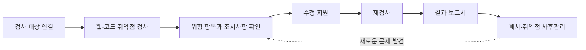
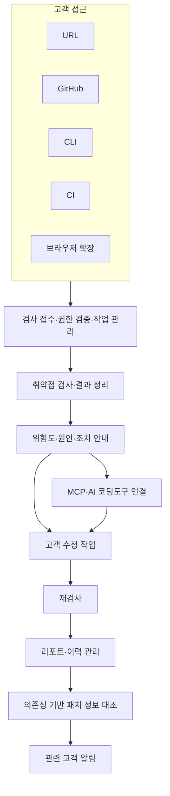
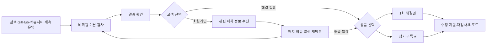
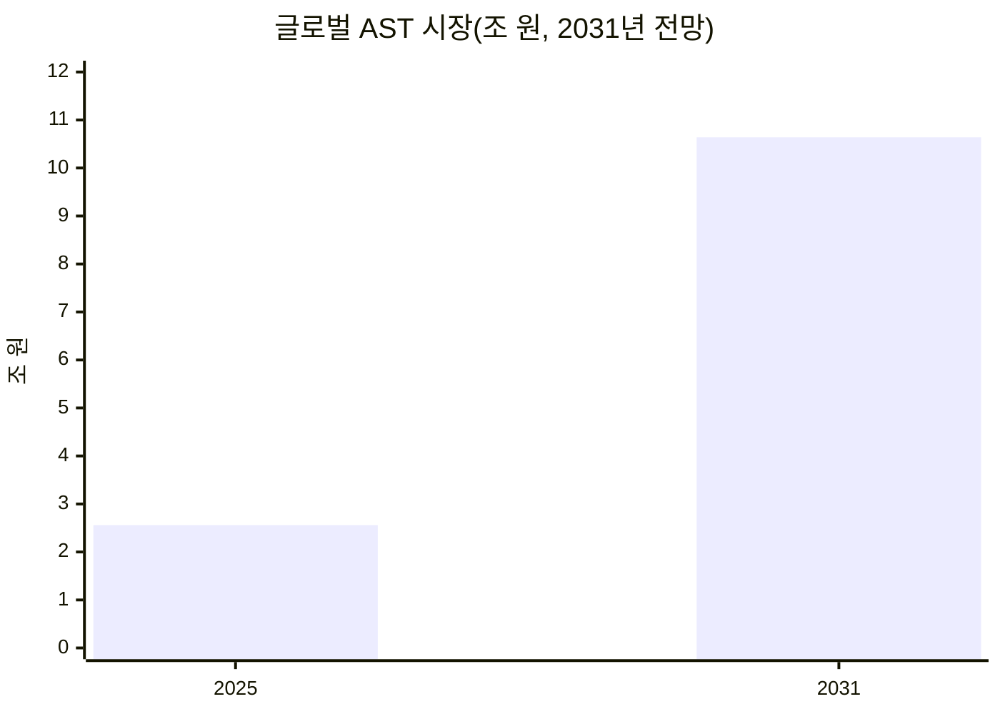
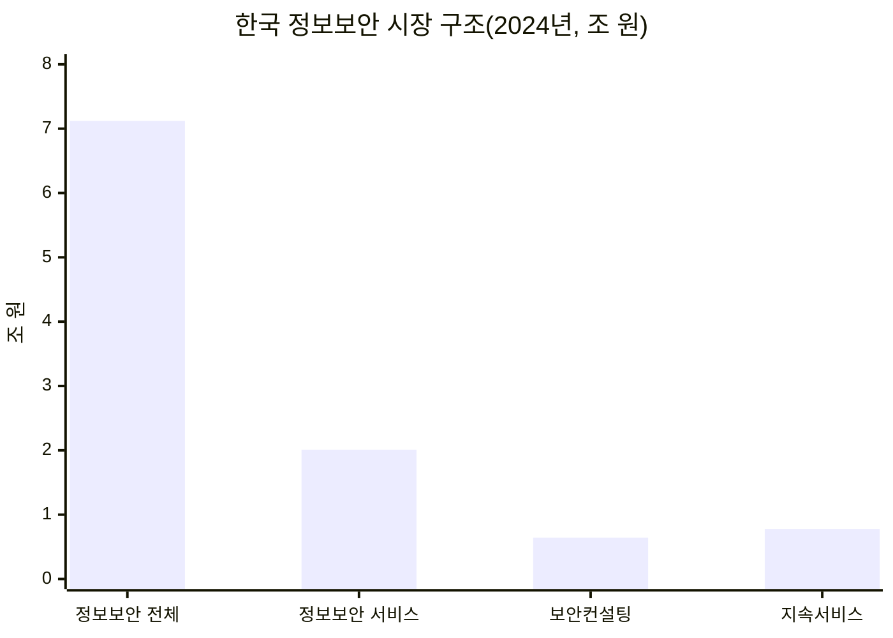
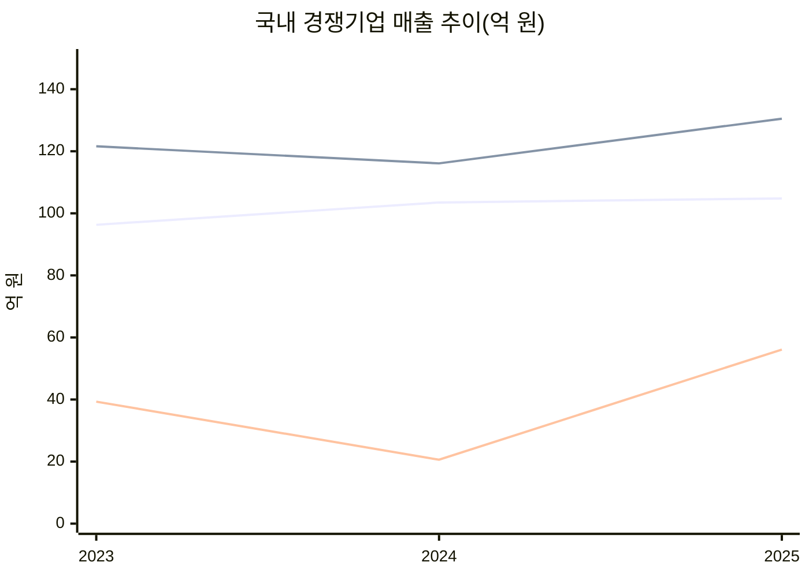
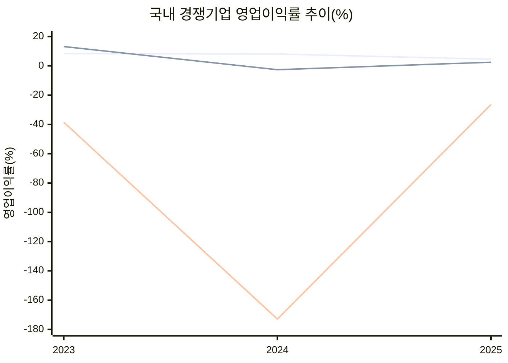
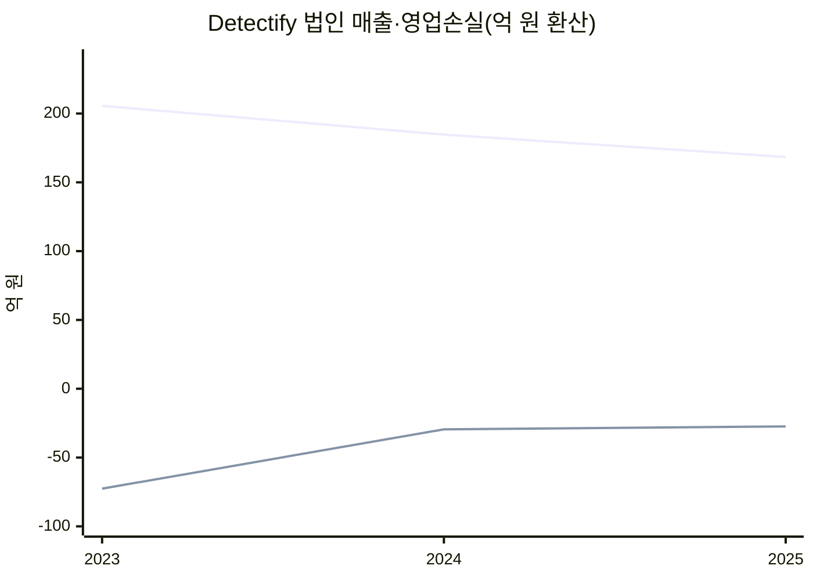
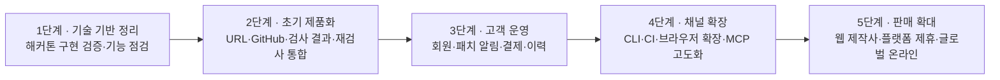

# 72hours | 기술 구현 및 상용화 사업전략 보고서

> **사업계획 검토본 v3.0** · 2026년 10월 31일  
> **범위:** 서비스 구성, 기술 구현·상용화 계획, 영업 및 수익모델, 국내외 시장규모, 국내외 유사기업 6개사의 재무 추이  
> **제외:** 개별 서비스 판매가격, AI 분석 모델·알고리즘·Red–Blue 등 AI 분석기술의 상세 구현 설명

---

## Executive Summary

| 핵심 항목 | 사업 방향 |
|---|---|
| **서비스** | 웹·소스코드 취약점 진단 → 수정 지원 → 재검사 → 결과 보고 및 지속 관리 |
| **초기 고객 접점** | 회원가입 없는 **URL·GitHub 검사** |
| **고객 관계** | 선택적 무료 회원가입을 통한 **관련 CVE·패치 정보 알림** |
| **유료 서비스** | 고객이 선택하는 **1회 해결권 또는 정기 구독권**, 기업·제작사 계약 |
| **연동 채널** | **URL · GitHub · CLI · CI · MCP · 브라우저 확장**, 총 6개 |
| **유통 방식** | 온라인 직접판매 중심 + 웹 제작사·유지보수사·플랫폼 제휴 |
| **글로벌 확장** | 국가별 현지 영업망보다 해외 사용자가 직접 찾아오는 온라인 구조; 영문 서비스는 중장기 |

### 핵심 시장 지표

| 구분 | 시장규모 | 기준과 해석 |
|---|---:|---|
| **글로벌 AST 시장** | **약 2.56조 원 (2025)** | 2031년 약 **10.64조 원** 전망. 웹·코드 검사에 가까운 **유관 시장** |
| **한국 정보보안 시장** | **약 7.12조 원 (2024)** | 국내 정보보안 **전체 산업**. 72hours 직접 시장 아님 |
| **한국 정보보안 서비스** | **약 2.01조 원 (2024)** | 보안관제·컨설팅·유지관리 등 포함. 직접 시장보다 넓은 참고 지표 |

> **시장 해석 원칙:** 국내 공개 통계에서 72hours와 정확히 일치하는 ‘웹·소스코드 취약점 검사·수정 지원’ 단일 시장 규모는 이번 조사에서 확인하지 못했습니다. 따라서 한국의 정보보안 산업과 정보보안 서비스는 **상위 참고시장**으로만 제시합니다. 무료/유료 정책은 **시장 세분화 기준이 아니라 영업 방식**입니다.

---

## 1. 서비스 및 고객 가치

72hours는 웹사이트와 소스코드의 보안 취약점을 진단하고, 발견된 문제에 대한 수정 지원, 조치 후 재검사, 증빙 보고서 및 후속 패치 정보를 하나의 서비스 흐름으로 제공하는 온라인 보안 플랫폼입니다.

**고객별 활용:** 개인 개발자·AI 코딩 사용자는 배포 전 검증, 스타트업·SaaS 기업은 개발 중 보안 관리, 소상공인·중소기업은 운영 웹사이트 점검, 웹 제작사·유지보수사는 다수 고객 사이트의 관리에 이용합니다.

## 2. 기술 구현 및 제품 구성

### 2.1 여섯 가지 연결·연동 채널

| 채널 | 접근 범위 및 역할 | 상용화 우선순위 |
|---|---|---|
| **URL** | 공개 페이지·JavaScript·HTTP 보안 헤더·쿠키·외부 노출 설정의 **비침투 검사** | **초기 핵심** |
| **GitHub** | 권한이 허용된 프론트·백엔드 코드, 의존성 및 설정 파일 검사 | **초기 핵심** |
| **CLI** | 지정 로컬 프로젝트 검사; 향후 고객 환경에서 검사 후 결과만 전송 | 개발자용 확장 |
| **CI** | 코드 변경·빌드·배포 과정에서 반복 검사 | 정기관리 확장 |
| **MCP** | 검사 결과와 수정 지시를 AI 코딩 에이전트로 전달하는 연동 인터페이스 | 수정 지원 연결 |
| **브라우저 확장** | 브라우저에서 관측 가능한 페이지·응답 기반 간편 검사·서비스 연결 | 고객 접점 확대 |

> **범위 구별:** URL만으로 백엔드 소스코드·DB 구현을 읽을 수 없으며, MCP는 그 자체가 모든 코드를 수집하는 검사 통로가 아닙니다. 검사는 대상 소유자의 허용 범위와 최소권한 원칙을 따릅니다.

### 2.2 상용 서비스 구조

**기술 구현 원칙:** 검증된 검사 도구를 결합하고, 서비스 운영에는 검사 접수·권한·결과 관리·수정 지원·재검사·보고 체계를 통합합니다. 세부 AI 분석 기법은 별도의 기술 문서로 관리하고 본 사업전략 보고서에서는 중복 기술하지 않습니다.

### 2.3 현재 기술과 제품화·확장 과제

| 구분 | 현재 기술·설계 근거 | 상용화 과제 |
|---|---|---|
| **기본 웹/API** | Next.js 프론트엔드, FastAPI 백엔드 및 DB 연결 구조 | 일반 사용자용 서비스 화면, 계정·결제·이력 통합 |
| **소스 검사** | 저장소·CLI 중심 검사 흐름 및 취약점 결과 규격 | 다중 고객 격리, 입력 보호, 검사 완료 자동화 |
| **URL 검사** | 기존 설계상 선택적 확장 후보 | 비침투 웹 진단 모듈 추가, 공개 결과 노출 통제 |
| **MCP 수정 연동** | JSON 검사 결과·수정 지시를 제공하는 MCP 구조 | 최신 검사 결과 조회, 고객별 권한 및 원격 연동 |
| **패치 알림** | 저장된 의존성 정보와 신규 CVE를 대조하는 설계 | 메일 수신동의, 타기팅, 구독·수신거부 운영 |
| **CLI·CI·확장** | CLI 업로드 및 CI 확장 후보 | 로컬 검사 고도화, CI 반복 검사, 브라우저 확장 개발 |

*기준 문서:* [프로젝트 README](https://github.com/maebsy/YMCA-hackathon-2026/blob/main/README.md), [시스템 흐름](https://github.com/maebsy/YMCA-hackathon-2026/blob/main/docs/system-flow.md), [경쟁기능 비교](https://github.com/maebsy/YMCA-hackathon-2026/blob/main/docs/competitors2.md). 설계된 기능과 운영 배포 완료 기능은 동일하지 않습니다.

---

## 3. 고객 확보·영업·수익 구조

### 3.1 고객 흐름 및 재방문 구조

**운영 원칙:** 무료 검사는 실질적인 기본 검사 결과를 제공합니다. 회원가입은 선택 사항이며, 무료 회원에게는 자신의 기술·의존성과 관련된 패치 정보가 핵심 혜택입니다. URL에서 확인되지 않은 내부 패키지 버전은 확정된 취약점처럼 표현하지 않습니다.

### 3.2 고객군과 판매채널

| 고객군 | 주된 수요 | 주요 영업 방식 |
|---|---|---|
| 개인 개발자·AI 코딩 사용자 | 자체 웹·코드 보안 확인 및 수정 지원 | 온라인 직접 유입·셀프서비스 |
| 스타트업·SaaS 기업 | 코드 변경 대응·정기 관리 | GitHub·CI 연동, 구독 |
| 소상공인·중소기업 | 운영 사이트의 보안 점검 및 조치 | URL 검사, 필요 시 단건 이용 |
| 웹 제작사·유지보수사 | 다수 고객 사이트 통합 관리 | 파트너 계약·다중 사이트 서비스 |
| 호스팅·플랫폼 기업 | 기존 고객 대상 부가 보안 서비스 | 중장기 공급·제휴 계약 |

### 3.3 상품·수익 체계 — 가격 미기재

| 상품/계약 | 제공 가치 | 과금 방식 |
|---|---|---|
| 비회원 기본 검사 | 취약점 유형·위험도·검사 범위 안내 | 무료 |
| 무료 회원 | 관련 CVE·보안 패치 지속 알림 | 무료 |
| **1회 해결권** | 선택한 문제의 수정 지원·재검사·결과 보고서 | 단건 결제 |
| **정기 구독권** | 지속 검사·수정 지원·정기 보고 및 관리 | 정기 결제 |
| **기업·제작사 계약** | 여러 사이트 관리, 고객별 보고서 | 기업 계약 |
| **플랫폼 제휴** | 기존 플랫폼 고객에게 보안 부가서비스 공급 | B2B 공급 계약 |

**운영원가 전략:** 경량 자동검사·캐시·호출 제한·작업 대기열을 활용하고, 계산량이 큰 심층 수정 지원과 재검사는 계약 범위 내에서 관리합니다.

### 3.4 홍보·노출 전략 — 간략

검색엔진의 취약점·패치 정보 페이지, GitHub, 개발자 커뮤니티, SNS, Chrome 확장 공개, 웹 제작사 제휴를 주요 노출 채널로 합니다. 사이트 소유자가 승인한 범위에서 검사일·검사 범위만 표시하는 **검사 확인 배지**도 검토합니다. 이는 ‘안전 인증’이 아닙니다.

---

## 4. 국제 및 한국 시장규모

### 4.1 국제: 애플리케이션 보안 테스트(AST)

시장조사기관 MarketsandMarkets는 AST 시장을 **2025년 18.3억 달러, 2031년 76.0억 달러**로 추정·전망합니다(공표 CAGR 26.7%). 웹·모바일, SAST·DAST·SCA 등을 포함한 **72hours의 유관 시장**입니다.

**원화 환산(비교용 고정 환율 USD 1 = KRW 1,400):** 2025년 **2.56조 원**, 2031년 **10.64조 원**.

출처: [MarketsandMarkets, Application Security Testing Market](https://www.marketsandmarkets.com/PressReleases/application-security-testing.asp).

### 4.2 한국: 확인 가능한 상위 시장 및 관련 서비스 시장

한국정보보호산업협회(KISIA) 「2025 국내 정보보호산업 실태조사」(2024년 실적) 기반으로 확인되는 수치는 다음과 같습니다.

| 지표 | 2024년 시장규모 | 해석 |
|---|---:|---|
| 국내 정보보호산업 전체 | **18.59조 원** | 물리보안 등을 포함하므로 직접 시장과 거리가 큼 |
| 국내 **정보보안** 산업 | **7.12조 원** | 정보보안 제품·서비스의 전체 참고시장 |
| 국내 **정보보안 서비스** | **2.01조 원** | 보안관제·컨설팅·보안 유지관리 등, 72hours보다 넓은 시장 |
| 보안컨설팅 서비스 | **약 0.643조 원** | 진단·컨설팅과 인접하나 동일 시장 아님 |
| 보안 유지관리·보안성 지속 서비스 | **약 0.777조 원** | 반복 관리 수요와 인접, 동일 시장 아님 |

> 도표의 서비스·컨설팅·지속서비스는 전체 시장과 **포함 관계**이므로 합산하면 안 됩니다. **한국의 웹·소스코드 보안 검사만의 독립된 시장규모는 별도 통계 확인이 필요합니다.**

출처: [KISIA 조사 소개](https://www.kisia.or.kr/ks/kboard_view.php?PN=71&no=120&page=1), [국내 보안시장 세부 내역 인용 공시](https://kind.krx.co.kr/external/2025/11/14/001125/20251114002440/11013.htm).

### 4.3 TAM·SAM·SOM의 적용

| 구분 | 산정 방식 |
|---|---|
| **TAM** | 글로벌 AST를 유관 전체시장 지표로 활용 |
| **SAM** | 웹·소스코드 취약점 진단·해결 지원을 실제 구매할 수 있는 고객의 지출로 별도 산정 |
| **SOM** | 제품 공급역량과 판매채널에 따른 초기 확보 가능 매출로 산정 |

현 단계에서 **SAM을 TAM의 임의 1%로 계산하지 않습니다.** 시장 구분은 상품이 제공하는 **기술·고객 범위**에 따라 이루어지며, 무료·유료 검사 정책과 무관합니다.

---

## 5. 국내외 유사기업 6개사 비교

### 5.1 기업 선정 — 서비스 유사성 중심

| 해외 기업 | 비교 영역 | 국내 기업 | 비교 영역 |
|---|---|---|---|
| **Aikido Security** | 개발자용 통합 보안 검사·수정 연계 | **스패로우** | 소스코드·오픈소스 분석 |
| **Detectify** | 운영 웹의 외부 취약점 검사 | **에스에스알(SSR)** | 자동 취약점 진단·웹 보안 |
| **Snyk** | 코드·의존성 보안 관리 | **AI스페라** | 외부 공격표면·위협 식별 |

### 5.2 국내 경쟁기업: 매출·영업이익·영업이익률 (2023~2025)

**단위: 억 원. 영업이익률 = 영업이익 / 매출 × 100.**

| 기업 | 2023 매출 | 2024 매출 | 2025 매출 | 2023 영업이익 | 2024 영업이익 | 2025 영업이익 | 2025 이익률 |
|---|---:|---:|---:|---:|---:|---:|---:|
| **스패로우** | 96.3 | 103.5 | 104.8 | 8.1 | 8.4 | 4.9 | **4.6%** |
| **에스에스알** | 121.6 | 116.1 | 130.5 | 16.0 | -3.1 | 3.2 | **약 2.5%** |
| **AI스페라** | 39.3 | 20.6 | 56.1 | -15.1 | -35.6 | -14.8 | **약 -26.4%** |

*라인 순서: 스패로우 → 에스에스알 → AI스페라.*

*라인 순서 동일. AI스페라의 2024년 높은 적자율로 인해 다른 두 회사 추이가 평평하게 보일 수 있습니다. 수치는 위 재무표와 함께 읽어야 합니다.*

**해석:** 스패로우는 매출이 소폭 증가했으나 영업이익률이 낮아졌고, 에스에스알은 2024년 적자 이후 2025년 흑자로 전환했습니다. AI스페라는 매출이 반등했지만 2025년에도 영업적자를 기록했습니다.

자료 출처: [스패로우(NICE 재무자료)](https://www.saramin.co.kr/zf_user/company-info/view-inner-finance/csn/c21SN1FkbkJHU3VCQzVRU2ZPakpmZz09/company_nm/%28%EC%A3%BC%29%EC%8A%A4%ED%8C%A8%EB%A1%9C%EC%9A%B0), [에스에스알(연결재무제표 요약)](https://sulsuljaemu.com/company/275630/), [AI스페라(NICE 재무자료)](https://www.saramin.co.kr/zf_user/company-info/view-inner-finance/csn/S0F6UXpma1BWVzBSaHFTb1o3NzVlQT09/company_nm/%28%EC%A3%BC%29%EC%97%90%EC%9D%B4%EC%95%84%EC%9D%B4%EC%8A%A4%ED%8E%98%EB%9D%BC).

### 5.3 해외 경쟁기업: 매출과 수익성 — 확인 범위 중심

해외 기업은 서로 다른 회계통화·법인 범위·자료 유형 때문에, **공시 또는 법인 재무에 근거한 실적**과 **회사가 발표한 성장 지표**를 분리합니다.

| 기업 | 확인 가능한 실적·지표 | 수익성 및 추이 | 비고 |
|---|---|---|---|
| **Snyk** | 2024년 매출 약 **4,210억 원**, 2025년 약 **4,360억 원** | 2025년 세전손실. 영업이익률은 원문 재무제표 별도 확인 필요 | 영국 Snyk Limited 그룹 실적, GBP 환산 |
| **Detectify** | 2023년 **약 206억 원** → 2024년 **185억 원** → 2025년 **168억 원** | 영업손실 2023년 약 **-73억 원** → 2024년 **-30억 원** → 2025년 **-27억 원** | 스웨덴 Detectify AB 법인 기준, SEK 환산 |
| **Aikido Security** | 2026년 1월 투자 발표에서 **전년도 매출 5배 성장** 등 성장 지표 발표 | 연도별 비교 가능한 재무제표·영업이익률 미확보 | ARR·기업가치를 회계 매출로 대체하지 않음 |

**표시용 고정 환산율:** 영국 파운드 1GBP = 1,900원, 스웨덴 크로나 1SEK = 135원. 과거 각 연도의 실제 평균 환율이 아닌 **비교용 가정**이므로 원화 추이는 환율 효과와 구분되지 않습니다.

*첫 번째 선은 매출, 두 번째 선은 영업이익(음수).* Detectify의 2025년 영업이익률은 약 **-16.3%**(영업손실 2,031.7만 SEK / 총매출 1억 2,472.7만 SEK)입니다.

출처: [영국 Companies House — Snyk 공시내역](https://find-and-update.company-information.service.gov.uk/company/09677925/filing-history), [Snyk 재무 요약](https://theaccounts.uk/company/09677925/snyk-limited/), [Detectify AB 법인 실적](https://www.rating.se/info1/detail/numbers/5569859084), [Aikido 공식 투자발표](https://www.aikido.dev/blog/aikido-funding-series-b).

> **비교 유의사항:** 국내·외 수치는 기업의 전체 사업 매출이며 ‘72hours와 동일한 검사 기능’ 매출만 분리된 값이 아닙니다. 특히 Detectify AB 법인 매출은 과거 대화의 제3자 추정 ‘Detectify 전체 매출’과 집계 범위가 달라 직접 대조할 수 없습니다.

### 5.4 경쟁환경에서의 사업 포지셔닝

| 비교 축 | 일반적인 기업 중심 보안 서비스 | 72hours의 지향점 |
|---|---|---|
| 서비스 진입 | 영업 문의 또는 개발환경 연동 | URL·GitHub 즉시 검사 |
| 고객 대응 | 탐지·모니터링 및 복잡한 관리 화면 | 문제 이해 → 수정 지원 → 재검사 → 보고 |
| 이용·계약 | 구독·기업 계약 중심 사례 다수 | 단건 선택 + 정기 구독 병행 |
| 고객 유지 | 계약 갱신·정기 검사 | 기술별 패치 알림과 필요 시 재이용 |
| 고객 확대 | 개발팀·기업 중심 | 개발자 + 소규모 사업자 + 웹 제작사 |

기존 기업에도 무료 체험과 수정 지원이 존재하므로, 72hours의 차별성은 **검사 결과를 실제 조치와 확인 단계까지 이어 주는 사용자 경험**에 집중합니다.

---

## 6. 상용화 로드맵

| 단계 | 주요 실행과제 | 사업적 산출물 |
|---|---|---|
| **기술 기반 검증** | 기존 코드·설계·테스트·실제 서비스 연동 범위 확인 | 구현 완료/미완료 기능표 |
| **초기 제품화** | URL 비침투 검사, GitHub 연동, 검사·수정·재검사·보고 흐름 | 일반 사용자용 서비스 |
| **고객 운영** | 선택적 회원가입, 관련 패치 알림, 결제·관리·데이터 보안 | 온라인 직접판매 체계 |
| **개발환경 확장** | 로컬 CLI 고도화, CI 반복검사, 브라우저 확장, MCP 고객별 연결 | 반복 이용 및 개발자 채널 |
| **사업 확장** | 웹 제작사·유지보수사·플랫폼 제휴, 영문화 및 글로벌 홍보 | B2B 제휴 및 글로벌 온라인 고객 |

**상용 운영의 필수요건:** 대상 소유권·검사 범위 확인, SSRF·과도한 스캔 방지, 비밀값 마스킹, 고객 데이터 격리, 저장기간·삭제 정책, 장애·비용 통제, 보고서의 검사 범위 명시.

---

## 7. 사업화 전략의 결론

72hours는 **웹·소스코드 취약점 검사와 수정 지원**이라는 명확한 제품 범위를 바탕으로, 온라인 직접판매와 웹 제작사·기업 제휴를 결합하는 사업을 지향합니다. 고객은 검사에서 문제 확인, 조치, 재검사, 보고 및 사후관리까지 일관된 서비스를 이용합니다.

국제시장 수치는 유관 AST 시장의 성장성을 보여 주고, 국내 정보보안 산업 및 서비스 통계는 한국의 상위 수요 기반을 보여 줍니다. 국내외 여섯 경쟁사의 매출·손익 추이는 실제로 사업화된 관련 솔루션 기업들이 존재하며, 매출의 성장 속도와 이익 구조가 기업별로 다르다는 점을 보여 줍니다.

고객 확보는 **비회원 검사 → 선택적 무료 회원의 관련 패치 알림 → 필요 시 단건 또는 구독 이용** 구조로 진행합니다. 이는 어디까지나 **고객 획득과 상품 판매 전략**이며 시장 규모 산정에 별도의 무료·유료 시장 구분을 적용하지 않습니다.

### 데이터 출처 및 해석 범위

1. [MarketsandMarkets — AST 시장(2025~2031)](https://www.marketsandmarkets.com/PressReleases/application-security-testing.asp)
2. [KISIA — 2025 정보보호산업 실태조사](https://www.kisia.or.kr/ks/kboard_view.php?PN=71&no=120&page=1)
3. [한국 정보보안 분야 세부 통계 인용 공시](https://kind.krx.co.kr/external/2025/11/14/001125/20251114002440/11013.htm)
4. [Sparrow — NICE 재무정보](https://www.saramin.co.kr/zf_user/company-info/view-inner-finance/csn/c21SN1FkbkJHU3VCQzVRU2ZPakpmZz09/company_nm/%28%EC%A3%BC%29%EC%8A%A4%ED%8C%A8%EB%A1%9C%EC%9A%B0)
5. [SSR — 연결재무제표](https://sulsuljaemu.com/company/275630/)
6. [AI Spera — NICE 재무정보](https://www.saramin.co.kr/zf_user/company-info/view-inner-finance/csn/S0F6UXpma1BWVzBSaHFTb1o3NzVlQT09/company_nm/%28%EC%A3%BC%29%EC%97%90%EC%9D%B4%EC%95%84%EC%9D%B4%EC%8A%A4%ED%8E%98%EB%9D%BC)
7. [Snyk — Companies House](https://find-and-update.company-information.service.gov.uk/company/09677925/filing-history)
8. [Snyk — 재무 요약](https://theaccounts.uk/company/09677925/snyk-limited/)
9. [Detectify AB — 2023~2025 재무](https://www.rating.se/info1/detail/numbers/5569859084)
10. [Aikido — 공식 투자 발표](https://www.aikido.dev/blog/aikido-funding-series-b)
11. [72hours — README](https://github.com/maebsy/YMCA-hackathon-2026/blob/main/README.md) · [시스템 플로우](https://github.com/maebsy/YMCA-hackathon-2026/blob/main/docs/system-flow.md)

*주: 원화 환산은 추이 비교의 편의를 위한 고정환율이며, 공식 회계 원화 실적이 아닙니다. 시장 전망은 외부 조사기관의 추정치입니다.*
