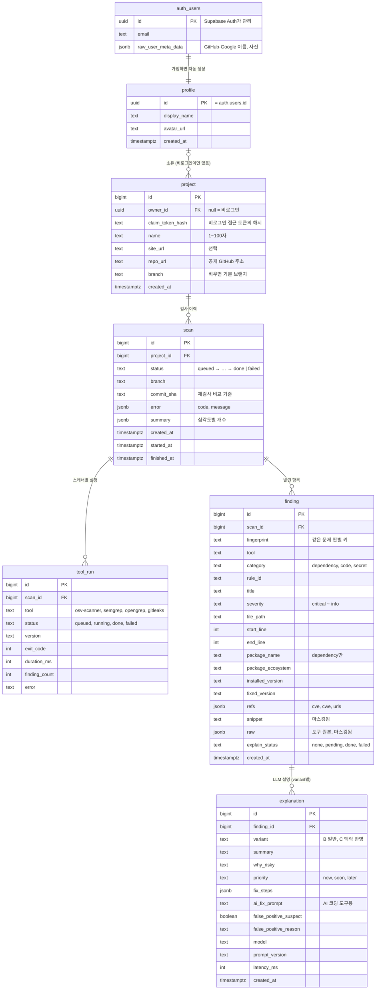

# DB 설계 (Supabase / PostgreSQL)

> **초안입니다.** 이 PR의 리뷰로 팀 합의를 거쳐 확정합니다. "결정 필요"라고 적힌 부분은 아직 정하지 않은 것입니다.

- 실행 SQL: [`db-schema.sql`](db-schema.sql)
- 검증: 로컬 Postgres 17에서 확인했습니다. 두 번 적용해도 안전하고, 다음이 모두 동작합니다.
  - 제약 조건과 연쇄 삭제
  - 회원가입 트리거 (GitHub·Google 정보 반영)
  - 비로그인 프로젝트를 가입 후 가져오기
  - 재검사 비교 쿼리

  `auth.users`는 같은 모양의 임시 테이블로 대신했고, 실제 Supabase 프로젝트에는 아직 적용하지 않았습니다.

## ERD



한 줄로 읽으면 이렇습니다. **프로젝트는 가입 사용자가 소유하거나, 비로그인이면 접근 토큰으로 본인을 확인합니다. 프로젝트마다 검사를 여러 번 하고, 검사 1번에 스캐너 실행 기록과 발견 항목이 여러 개 생기며, 발견 항목마다 LLM 설명이 붙습니다.**

## 테이블 요약

| 테이블 | 한 행이 뜻하는 것 | 생기는 시점 |
|---|---|---|
| `auth.users` | 로그인 계정 (Supabase가 관리) | 회원가입 |
| `profile` | 가입한 사용자의 서비스 정보 | 회원가입 때 트리거가 자동 생성 |
| `project` | 검사 대상 사이트 1개 | 검사할 저장소를 등록할 때 (로그인 여부와 무관) |
| `scan` | 검사 엔진을 한 번 돌린 기록 | "검사 시작"을 누를 때 |
| `tool_run` | 검사 1회 안의 스캐너 1개 실행 | 스캐너를 돌릴 때 |
| `finding` | 정규화된 발견 항목 1개 | 결과 정규화 후 |
| `explanation` | 발견 항목 1개에 대한 LLM 설명 | LLM 호출 후 |

## 로그인

### 원칙
- **로그인 없이도 검사할 수 있습니다.** 리포트를 받으려면 가입합니다.
- **가입은 OAuth로 합니다: Google, GitHub.** 비밀번호를 우리가 다루지 않습니다.
- 로그인 자체는 Supabase Auth가 처리하고, 백엔드는 토큰만 검증합니다.

### 비로그인 사용자 흐름
```
1. 저장소 주소만 넣고 검사 시작
   → 백엔드가 project(owner_id 없음)와 scan을 만들고, 무작위 접근 토큰을 발급
   → DB에는 토큰의 SHA-256 해시만 저장 (원문은 응답으로 한 번만 돌려줌)
2. 프론트는 토큰을 브라우저에 보관하고, 결과 조회 때 함께 보냄
3. 리포트를 받으려고 가입하면 토큰으로 "내 프로젝트로 가져오기"
   → owner_id를 채우고 토큰 해시는 지움
```

**결정 필요: 비로그인과 가입 사용자에게 각각 무엇을 보여 줄지는 기획에서 정해야 합니다.** 예를 들면 비로그인은 심각도별 개수와 항목 목록까지, 가입하면 LLM 설명·AI 수정 지시·재검사 비교·이력까지 보여 주는 식입니다. DB 구조는 어느 쪽으로 정해도 바뀌지 않고, API에서 응답 범위만 달라집니다.

### 가입 사용자 흐름
```
[프론트] Supabase Auth로 Google 또는 GitHub 로그인
   → 받은 access token을 API 요청 헤더에 붙임: Authorization: Bearer <token>
[FastAPI] 토큰 검증 → 토큰의 sub(사용자 UUID) = profile.id
   → 그 사용자 소유의 project와 하위 데이터만 조회·수정
```

- **이메일은 Supabase(`auth.users`)에만 있습니다.** 우리 테이블에는 복사하지 않습니다.
- **이름과 프로필 사진은 가입할 때 자동으로 채워집니다.** GitHub 아이디나 Google 이름을 가져옵니다.
- **다른 사람의 프로젝트를 요청하면 `404`로 응답합니다.** 존재 여부 자체를 알려 주지 않기 위해서입니다.

### 주의할 점
- **비로그인 검사는 남용될 수 있습니다.** 누구나 GPU를 쓰게 되므로, 백엔드에서 IP당 횟수 제한을 걸어야 합니다. 한도 수치는 결정 필요입니다. IP는 메모리에서만 세고 DB에 저장하지 않는 것을 권장합니다.
- **가져가지 않은 비로그인 프로젝트는 일정 기간 뒤 지웁니다.** 보관 기간은 결정 필요입니다.

## Google·GitHub OAuth 설정 (한 번만)

두 개 모두 Supabase가 기본으로 지원해서 어렵지 않습니다. 각각 30분 안쪽 작업입니다. 콜백 주소는 둘 다 `https://<프로젝트 ref>.supabase.co/auth/v1/callback`입니다.

| 단계 | GitHub | Google |
|---|---|---|
| 1. 앱 등록 | GitHub **Settings → Developer settings → OAuth Apps**에서 새 앱을 만들고 콜백 주소를 입력 | Google Cloud Console **API 및 서비스 → OAuth 동의 화면** 설정 후, **사용자 인증 정보 → OAuth 클라이언트 ID(웹)**를 만들고 승인된 리디렉션 URI에 콜백 주소를 입력 |
| 2. Supabase에 등록 | **Authentication → Providers → GitHub**에 Client ID와 Secret 입력 | **Authentication → Providers → Google**에 Client ID와 Secret 입력 |
| 3. 프론트 | `supabase.auth.signInWithOAuth({ provider: 'github' })` | `supabase.auth.signInWithOAuth({ provider: 'google' })` |

- **Client Secret은 Supabase 대시보드에만 넣습니다.** 저장소와 `.env`에는 넣지 않습니다.
- **Google 동의 화면이 "테스트" 상태면 등록한 테스트 사용자만 로그인할 수 있습니다.** 데모 전에 "프로덕션"으로 바꾸거나 심사위원 시연 계정을 테스트 사용자로 넣어 두세요. 이메일·프로필 같은 기본 권한만 쓰면 별도 심사가 필요 없습니다.
- 백엔드 코드는 어느 제공자로 로그인했든 똑같습니다. 토큰 형식이 같기 때문입니다.

## 팀이 Supabase를 함께 쓰는 법

- **팀 공용 Supabase 프로젝트를 1개 만듭니다.** 한 사람이 Organization을 만들고 그 안에 프로젝트를 만듭니다. 백엔드·DB 담당을 권장합니다.
- **나머지 팀원은 Organization에 초대합니다.** 대시보드의 Organization 설정 → Team에서 이메일로 초대하면, 각자 자기 계정으로 같은 프로젝트를 보고 SQL을 실행할 수 있습니다.
- **백엔드 접속 주소(`DATABASE_URL`)는 팀 채팅으로 공유하고 각자 `.env`에 넣습니다.** 저장소에는 절대 커밋하지 않습니다.
- **개발할 때는 각자 로컬 SQLite를 쓰고, 공용 Supabase는 통합 테스트와 데모용으로 씁니다.** 공용 DB에 각자 테스트 데이터를 넣으면 서로 섞여서 데모 데이터가 지저분해집니다.

## 검사 엔진과 scan

팀에서 말하는 **검사 엔진**은 소스 가져오기, 스캐너 실행, 결과 정규화를 하는 코드 덩어리입니다. `scan`은 그 엔진을 **한 번 돌린 기록**입니다.

| 이름 | 무엇인가 | 비유 |
|---|---|---|
| 검사 엔진 | 검사를 수행하는 코드 | 건강검진 기계 |
| `scan` | 엔진을 한 번 돌린 기록 (DB 한 행) | 검진 1회 기록지 |

- **LLM 설명(`explanation`)은 엔진 밖에 둡니다.** "탐지(스캐너)와 해석(LLM)을 분리하라"는 멘토 권고를 구조로도 지키기 위해서입니다.
- **코드로 옮길 때 이름 충돌에 주의합니다.** 엔진은 `backend/app/engine/`에 모으는 걸 제안합니다. 그런데 `backend/app/db.py`의 DB 연결 변수 이름도 `engine`(SQLAlchemy 관례)이라, 그쪽을 `db_engine`으로 바꾸는 게 좋습니다.

## DB가 직접 막아 주는 규칙

| 규칙 | 구현 | API 쪽 효과 |
|---|---|---|
| 프로젝트는 주인 또는 접근 토큰이 반드시 있음 | `check (owner_id is not null or claim_token_hash is not null)` | 아무도 접근할 수 없는 프로젝트가 생기지 않음 |
| 접근 토큰은 프로젝트마다 다름 | `claim_token_hash` 부분 유니크 인덱스 | 토큰 하나로 한 프로젝트만 열림 |
| 프로젝트당 진행 중 검사는 1개 | `scan` 부분 유니크 인덱스 (`status`가 done·failed가 아닌 행만) | 동시에 두 번 눌러도 하나만 들어감 → `409 SCAN_ALREADY_RUNNING` |
| 한 검사 안에서 같은 문제는 1개 | `finding (scan_id, fingerprint)` 유니크 | 중복 제거를 DB가 보장 |
| 같은 항목·같은 variant 설명은 1개 | `explanation (finding_id, variant)` 유니크 | 재생성은 덮어쓰기(upsert) |
| 라이브러리 취약점은 패키지 이름 필수 | `category <> 'dependency' or package_name is not null` | 정규화 버그를 저장 단계에서 잡음 |
| 상태·심각도 값은 정해진 것만 | `check (... in (...))` | 오타 저장 방지 |
| 계정을 지우면 그 사람의 데이터 모두 삭제 | `auth.users`부터 `on delete cascade` 연쇄 | 탈퇴 처리와 데모 데이터 정리가 한 번에 됨 |

## 이렇게 고른 이유

- **위치·패키지 정보는 JSON이 아니라 컬럼으로 풀었습니다.** "이 파일의 문제만", "lodash 관련만"처럼 걸러 보기 쉽습니다. API 응답에서는 `location`, `package` 객체로 다시 묶어서 내보냅니다.
- **`references` 대신 `refs`라는 이름을 썼습니다.** `references`는 SQL 예약어라 컬럼 이름으로 쓰면 번거롭습니다. API 응답의 필드 이름은 `references` 그대로 둡니다.
- **스캐너 실행 기록은 별도 테이블(`tool_run`)로 뒀습니다.** 도구별 성공·실패와 소요 시간이 남아 평가와 디버깅이 쉬워집니다.
- **상태·심각도는 Postgres enum이 아니라 `text + check`로 했습니다.** 값을 추가하기 쉽고 로컬 SQLite 개발 환경과도 호환됩니다. 심각도 정렬은 쿼리에서 `case`로 처리합니다.
- **재검사 비교용 테이블은 따로 없습니다.** 두 검사의 `finding.fingerprint`를 비교하는 쿼리로 해결됨·남음·새로 생김을 계산합니다. `fingerprint`에는 줄 번호를 넣지 않습니다. 코드를 고치면 줄이 밀리기 때문입니다.
- **접근 토큰은 해시로만 저장합니다.** DB가 유출돼도 토큰 원문으로 남의 결과를 열 수 없습니다.
- **`explanation.variant`, `prompt_version`, `latency_ms`는 평가 실험용입니다.** LLM 담당의 A/B/C 평가와 프롬프트 비교에 씁니다. A안(스캐너 원문)은 `finding.raw`라서 설명 행이 없습니다.

## Supabase 관련

- **모든 테이블에 RLS를 켜고 정책은 비워 뒀습니다.**
  - 프론트는 Supabase 키(publishable/anon)를 **로그인에만** 쓰고, 데이터는 전부 FastAPI를 거칩니다.
  - 그래서 그 키로 Supabase 자동 REST API를 호출해도 아무 테이블도 읽거나 쓸 수 없습니다.
  - 백엔드는 `postgres` 계정으로 직접 접속하기 때문에 RLS의 영향을 받지 않습니다.
- **회원가입 트리거(`on_auth_user_created`)는 Supabase 공식 문서의 사용자 데이터 관리 방식과 같은 구조입니다.**
- **ID는 `bigint generated by default as identity`입니다.** Supabase 대시보드에서 테이블을 만들 때의 기본 방식과 같습니다.
- **실패한 insert도 ID 번호를 하나 소모합니다.** Postgres의 정상 동작이라 ID가 1, 3처럼 건너뛸 수 있습니다. 코드에서 ID가 연속이라고 가정하면 안 됩니다.

## Supabase에 적용하고 ERD 보기

1. 위 "Google·GitHub OAuth 설정"을 마칩니다. 로그인 없이 검사만 시험할 거라면 나중에 해도 됩니다.
2. **SQL Editor**에 `db-schema.sql` 전체를 붙여 넣고 **Run**을 누릅니다.
3. **Database → Schema Visualizer**에서 위 ERD와 같은 그림을 확인합니다.

## 백엔드 코드와 맞출 것

- 골격의 예시 `Item` 테이블과 `/api/items`를 지우고, 이 테이블들을 `backend/app/models.py`(SQLModel)로 옮깁니다.
- **테이블을 어디서 만들지 하나로 정해야 합니다.**
  - **(권장)** 이 SQL을 기준으로 삼고 Supabase에는 SQL로 적용합니다. 서버 시작 시 `create_all`은 로컬 SQLite 개발용으로만 씁니다.
  - 다른 방법은 SQLModel `create_all`만 쓰는 것입니다. 이 경우 부분 유니크 인덱스, check 제약, 회원가입 트리거를 모델이나 별도 코드로 직접 만들어야 합니다.
- **로컬 SQLite에는 `auth.users`가 없습니다.** 그래서 로컬 개발용으로는 "고정된 개발용 사용자"로 동작하는 모드가 필요합니다.
  - 예: `.env`에 `AUTH_DEV_USER_ID`를 넣으면 로그인 검사를 건너뜁니다.
  - 이 모드는 `DATABASE_URL`이 Postgres(Supabase)일 때 **서버가 시작을 거부**해야 합니다. 실서버에서 실수로 켜지면 모든 데이터가 열리기 때문입니다.
- 컬럼을 바꿀 때는 SQL과 모델을 같은 PR에서 같이 고칩니다.

## 나중에 붙일 것

| 기능 | 추가할 것 |
|---|---|
| 요금제·결제 | 가격·한도가 정해지면 `plan` 테이블(코드, 이름, 월 요금, 월 검사 한도, 프로젝트 한도)과 `profile.plan_code`를 추가하고, 한도를 넘으면 `402`로 응답합니다. 실제 결제를 하려면 `payment` 테이블(사용자, 금액, PG사, 주문번호, 상태)이 필요하고, 사업자 등록과 PG 계약이 있어야 합니다 |
| ZIP 업로드 검사 | `scan.source_type` (`github` / `zip`). 업로드 파일은 Supabase Storage에 둡니다 |
| URL 외부 검사 엔진 | `scan.kind` (`code` / `url`). 코드 검사와 별도 엔진으로 둡니다 |
| 정기 검사·알림 | `project.schedule`, `notification` 테이블 |
| 평가 결과 기록 | `evaluation` 테이블 (finding_id, variant, 평가자, 이해도·조치 성공 점수) |
