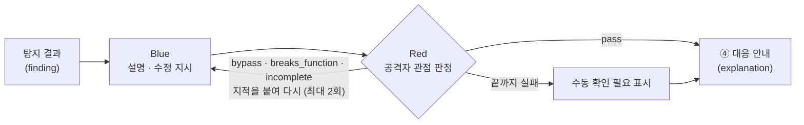

# 로컬 GPU LLM 해석 (③ 해석 · GPU)

탐지 결과 1건을 비개발자가 이해하고 바로 고칠 수 있는 설명·수정 지시로 바꾸고, 그 수정 지시를 공격자 관점에서 검증합니다.
코드는 우리 GPU 서버 밖으로 나가지 않습니다.



| 모드 | 평가 | 호출 수 | 용도 |
|---|---|---|---|
| `blue` | C | Blue 1회 | 빠른 설명, GPU 효과(C − B) 비교 |
| `red_blue` (기본) | D | Blue 1~3회 + Red 1~3회 | 서비스 기본, Red–Blue 효과(D − C) 비교 |

## 모델과 서버

| 항목 | 값 |
|---|---|
| 모델 | [Qwen3.8-27B](https://huggingface.co/Qwen/Qwen3.8-27B) (Apache-2.0) |
| 체크포인트 | [avyukth/Qwen3.8-27B-AWQ-INT4](https://huggingface.co/avyukth/Qwen3.8-27B-AWQ-INT4) @ `5a2ee524cbc9` (Apache-2.0, 4비트, 가중치 17.7GiB) |
| 서빙 | vLLM 0.32.0, GPU 서버 L4 24GB, `127.0.0.1:8001`, API 키 필수 |
| 대비책 | 같은 계열 [Qwen3.5-9B](https://huggingface.co/Qwen/Qwen3.5-9B) 공식 가중치. `LLM_MODEL_REPO`만 바꿔 띄우면 코드는 그대로 |

- 27B 원본(BF16 55.6GB)과 공식 FP8(약 28GB)은 L4에 들어가지 않아 4비트 체크포인트를 씁니다.
- 체크포인트는 safetensors만 있고 `--trust-remote-code` 없이 로드되는 것으로 골랐습니다. 커밋 해시로 고정합니다.
- Blue는 생각 모드를 끄고 바로 씁니다. Red는 우회 경로를 따져야 해서 `reasoning_effort: low`로 짧게 생각하게 합니다.

## GPU 서버에서 띄우기

```bash
# 한 번만: ~/venv-vllm 에 vLLM 설치 + 모델 내려받기 (사용자 공간만 씀)
bash scripts/llm/setup-gpu.sh

# 실행 (tmux 안에서 띄우면 SSH를 끊어도 계속 돕니다)
tmux new -d -s vllm 'bash scripts/llm/serve.sh'
```

`serve.sh`는 처음 실행할 때 API 키를 만들어 `~/.config/ymca/vllm-api-key`에 둡니다(권한 600). 이 값을 내 PC `.env`의 `LLM_API_KEY`에 넣습니다. 팀 공유는 채팅으로 하고 커밋하지 않습니다.

## 내 PC에서 쓰기

```bash
ssh -N -L 8001:127.0.0.1:8001 <GPU 서버>     # 터널은 열어 둔 채로
curl http://localhost:8000/api/llm/health    # {"status":"ok","model":"qwen3.8-27b"}
```

```bash
curl -X POST http://localhost:8000/api/llm/explain \
  -H 'Content-Type: application/json' \
  -d '{"mode": "red_blue", "findings": [ ...finding... ]}'
```

- 요청 한 번에 50건까지 받습니다. 여러 건을 한 번에 보내야 GPU가 묶어서 처리해 전체 시간이 줄어듭니다.
- 한 건이 실패해도 나머지 결과는 돌아옵니다(`status: "failed"`, `error_code`). 모두 서버 문제로 실패하면 `503 LLM_UNAVAILABLE`입니다.
- 예시 입력: [`backend/tests/fixtures/findings.json`](../backend/tests/fixtures/findings.json)

## 입력·출력 규격

- 입력 `FindingInput`: DB `finding` 테이블(#7)과 칼럼 이름이 같습니다. 보안엔진(#15)의 LLM 입력 꾸러미를 이 모양으로 바꿔 넣습니다.
- 출력 `Explanation`: DB `explanation` 테이블 칼럼에 Red–Blue 결과(`attack_scenario`, `red_verdict`, `red_rounds`, `needs_manual_review`)를 더했습니다.
- 정의: [`backend/app/llm/schemas.py`](../backend/app/llm/schemas.py)

## 안전장치

| 위험 | 대응 |
|---|---|
| 사용자 코드 속 문장이 모델에게 지시를 내림 (지시문 주입) | 탐지 결과는 `<finding>` 블록 안의 데이터로만 넘기고 따르지 말라고 명시. 닫는 태그는 이스케이프 |
| 비밀값이 모델 입력·출력에 남음 | 보안엔진이 가린 뒤 여기서도 입력을 다시 가리고, 출력(수정 지시는 외부 AI 코딩툴로 감)도 가림 |
| 형식이 깨진 응답 | vLLM에 JSON 스키마를 강제하고, 검증에 실패하면 이유를 붙여 1회 재요청 |
| 한국어 답에 한자·중국어가 섞임 | 섞이면 1회 다시 쓰게 하고 로그를 남김 |
| Red가 공격 코드를 씀 | 시나리오 문장만 쓰게 하고, 코드 블록이 있으면 다시 쓰게 함 |
| GPU 과부하·서버 꺼짐 | 동시 요청 8개 제한, 5xx·시간 초과는 2회 재시도 후 `LLM_UNAVAILABLE` |

## 테스트

```bash
cd backend
pip install -r requirements-dev.txt
pytest -q                                  # 가짜 vLLM 응답으로 전체 검사 (CI에서도 돕니다)
LLM_LIVE=1 pytest -m live -s               # 실제 vLLM (터널 필요)
python -m app.llm.check                    # 예시 5건으로 형식·한국어·속도 측정, outputs/ 에 저장
```
