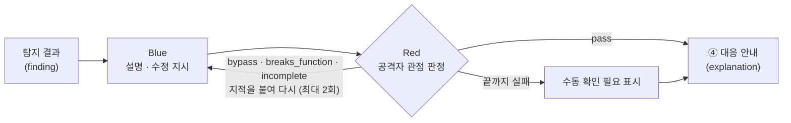

# 로컬 GPU LLM 해석 (③ 해석 · GPU)

탐지 결과 1건을 비개발자가 이해하고 바로 고칠 수 있는 설명·수정 지시로 바꾸고, 그 수정 지시를 공격자 관점에서 검증합니다.
코드는 우리 GPU 서버 밖으로 나가지 않습니다.



| 모드 | 평가 | 호출 수 | 용도 |
|---|---|---|---|
| `blue` | C | Blue 1회 | 빠른 설명, GPU 효과(C − B) 비교 |
| `red_blue` (기본) | D | Blue 1~3회 + Red 1~3회 | 서비스 기본, Red–Blue 효과(D − C) 비교 |

## 모델과 서버

| 항목 | 값 |
|---|---|
| 모델 | [Qwen3.8-27B](https://huggingface.co/Qwen/Qwen3.8-27B) (Apache-2.0) |
| 체크포인트 | [avyukth/Qwen3.8-27B-AWQ-INT4](https://huggingface.co/avyukth/Qwen3.8-27B-AWQ-INT4) @ `5a2ee524cbc9` (Apache-2.0, 4비트, 가중치 17.7GiB) |
| 서빙 | vLLM 0.32.0, GPU 서버 L4 24GB, 문맥 12K(`--max-model-len 12288`), `127.0.0.1:8001`, API 키 필수 |
| 대비책 | 같은 계열 [Qwen3.5-9B](https://huggingface.co/Qwen/Qwen3.5-9B) 공식 가중치. `LLM_MODEL_REPO`만 바꿔 띄우면 코드는 그대로 |

- 27B 원본(BF16 55.6GB)과 공식 FP8(약 28GB)은 L4에 들어가지 않아 4비트 체크포인트를 씁니다.
- 체크포인트는 safetensors만 있고 `--trust-remote-code` 없이 로드되는 것으로 골랐습니다. 커밋 해시로 고정합니다.
- Blue는 생각 모드를 끄고 바로 씁니다. Red는 우회 경로를 따져야 해서 `reasoning_effort: low`로 짧게 생각하게 합니다.

## GPU 서버에서 띄우기

```bash
# 한 번만: ~/venv-vllm 에 vLLM 설치 + 모델 내려받기 (사용자 공간만 씀)
bash scripts/llm/setup-gpu.sh

# 실행 (tmux 안에서 띄우면 SSH를 끊어도 계속 돕니다)
tmux new -d -s vllm 'bash scripts/llm/serve.sh'
```

`serve.sh`는 처음 실행할 때 API 키를 만들어 `~/.config/ymca/vllm-api-key`에 둡니다(권한 600). 이 값을 내 PC `.env`의 `LLM_API_KEY`에 넣습니다. 팀 공유는 채팅으로 하고 커밋하지 않습니다.

### L4 실측 (10/31, 예시 5건 동시)

| 모드 | 프롬프트 | 5건 전체 | 건당 지연 중앙값 | 처리량 | 결과 |
|---|---|---|---|---|---|
| Blue (C) | `.2` | 46.5초 | 41.6초 | 57.5 토큰/초 | 5건 모두 형식 통과, 한자 0 |
| Red–Blue (D) | `.2` | 155.5초 | 137.8초 | 54.7 토큰/초 | 5건 모두 형식 통과, 한자 0 |
| Red–Blue (D) | `.3` | 244.6초 | 116.4초 | 40.1 토큰/초 | 5건 모두 형식 통과, 한자 0. 키 노출 건 Red가 길게 생각해 244초 |
| Red–Blue (D), 보안엔진 예시 입력 | `.4` (현재) | 115.0초 | 112.5초 | 37.4 토큰/초 | 열린 문제 3건 통과·한자 0, 코드에서 해결된 2건은 건너뜀 |

- 한 건만 보내면 초당 약 15토큰이라 Blue 1건에 40초 안팎이 걸립니다. 데모에서는 검사가 끝나는 대로 미리 돌려 저장해 두고 보여 줍니다.
- GPU 메모리: 가중치 16.7GiB + KV 캐시(문맥 12K 기준 20,048토큰). 서버를 띄우는 데 약 3분 걸립니다(컴파일 결과는 캐시되어 다음부터 빨라짐).
- 첫 실측에서 Red가 키 노출 건의 첫 수정안을 `bypass`로 막았고(환경 변수 이름을 잘못 지으면 키가 다시 브라우저에 노출됨), Blue가 다시 써서 통과했습니다.

### 알려진 한계

- **Red가 탐지 범위 밖의 문제는 잘 잡지 못합니다.** SQL 주입 건에서 매개변수 쿼리로 고친 뒤에도 URL의 `uid`만 바꾸면 남의 주문이 보이는 문제(권한 확인 누락, IDOR)를 `low`·`medium` 모두 통과시켰습니다. 이런 문제는 Red에게 맡기지 말고 탐지 규칙으로 따로 잡아야 합니다.
- Red의 생각 깊이는 `.env`의 `LLM_RED_REASONING_EFFORT`(기본 `low`)로 바꿀 수 있습니다. `medium`은 같은 건에서 Red 시간이 70초→122초로 늘었고 판정은 같았습니다.

### 서버에서 겪은 문제와 해결

| 증상 | 원인 | 해결 (사용자 공간만) |
|---|---|---|
| `Python.h: No such file or directory` | Triton이 C 확장을 컴파일하는데 서버 python3에 개발 헤더가 없음 | 헤더가 있는 uv 관리 파이썬으로 venv 생성 (`setup-gpu.sh`) |
| `No such file or directory: 'ninja'` (FlashInfer 샘플러) | 서버에 nvcc·ninja가 없어 샘플링 커널을 JIT 컴파일할 수 없음 | `VLLM_USE_FLASHINFER_SAMPLER=0` (`serve.sh`) |
| 응답 문장이 중간에서 잘림 | vLLM이 JSON 스키마의 글자 수 한도에서 자르는데, 모델은 한도를 모름 | 프롬프트에 항목별 분량을 적고, 한도까지 찬 항목은 다시 쓰게 함 |

GPU를 다른 실험에 쓰려면 `tmux kill-session -t vllm`으로 내립니다. vLLM이 L4 메모리의 95%를 씁니다.

## 내 PC에서 쓰기

```bash
ssh -N -L 8001:127.0.0.1:8001 <GPU 서버>     # 터널은 열어 둔 채로
curl http://localhost:8000/api/llm/health    # {"status":"ok","model":"qwen3.8-27b"}
```

```bash
curl -X POST http://localhost:8000/api/llm/explain \
  -H 'Content-Type: application/json' \
  -d '{"mode": "red_blue", "findings": [ ...finding... ]}'
```

- 요청 한 번에 50건까지 받습니다. 여러 건을 한 번에 보내야 GPU가 묶어서 처리해 전체 시간이 줄어듭니다.
- 한 건이 실패해도 나머지 결과는 돌아옵니다(`status: "failed"`, `error_code`). 모두 서버 문제로 실패하면 `503 LLM_UNAVAILABLE`입니다.
- 예시 입력: [`backend/tests/fixtures/findings.json`](../backend/tests/fixtures/findings.json)

## 입력·출력 규격

- 입력 `FindingInput`: DB `finding` 테이블(#7)과 칼럼 이름이 같습니다. 심각도는 `critical`~`info`와 `unknown`(엔진이 심각도를 모를 때)을 받습니다.
- 보안엔진(#15)의 LLM 입력 꾸러미는 [`engine_adapter.from_engine_payload`](../backend/app/llm/engine_adapter.py)로 바꿉니다. 엔진의 `flags`, `fix_hint`, `what`, `status`, `change`도 그대로 모델에 넘깁니다.
  - `likely_public_key`는 오탐 의심의 근거로, `suppressed_by_comment`·`ignored_by_config`는 숨김 주석·설정을 지우라는 안내와 Red 판정에 씁니다.
  - `fix_hint.target_version`·`command`가 있으면 그 버전과 명령을 그대로 안내합니다.
  - 엔진 규격이 바뀌면 [`tests/fixtures/engine_llm_input.json`](../backend/tests/fixtures/engine_llm_input.json)(엔진 예시 사본)을 바꾸고 계약 테스트를 돌립니다.
- **건너뛰는 항목**: GPU를 쓰지 않고 `skipped`와 이유(`reason`)를 돌려줍니다.
  - `status: code_resolved`: 코드에서 이미 해결됨
  - `status: out_of_scope`: 재검사에서 도구가 실패해 확인하지 못함. 화면에는 "다시 검사 필요"로 보여 줍니다
  - `change`가 `resolved`여도 `status`가 `runtime_check_needed`면(코드에서 지운 비밀값의 키 재발급처럼 할 일이 남음) 설명합니다
- 출력 `Explanation`: DB `explanation` 테이블 칼럼에 Red–Blue 결과(`attack_scenario`, `red_verdict`, `red_rounds`, `needs_manual_review`)를 더했습니다.
- 정의: [`backend/app/llm/schemas.py`](../backend/app/llm/schemas.py)

## 안전장치

| 위험 | 대응 |
|---|---|
| 사용자 코드 속 문장이 모델에게 지시를 내림 (지시문 주입) | 탐지 결과는 `<finding>` 블록 안의 데이터로만 넘기고 따르지 말라고 명시. 닫는 태그는 이스케이프 |
| 비밀값이 모델 입력·출력에 남음 | 보안엔진이 가린 뒤 여기서도 입력을 다시 가리고, 출력(수정 지시는 외부 AI 코딩툴로 감)도 가림. 따옴표 없는 `.env`·compose 대입(`DB_PASSWORD=…`)과 Supabase 새 키(`sb_secret_…`)도 가림 |
| 입력이 모델 문맥(12K 토큰)을 넘음 | 항목별 글자 수 예산으로 자름(현실적 최악 입력이 Red 9,037토큰으로 들어감). 그래도 vLLM이 문맥 초과로 거부하면 예산을 50%, 25%로 줄여 다시 보내고, 끝내 넘으면 `LLM_INPUT_TOO_LONG` |
| 형식이 깨진 응답 | vLLM에 JSON 스키마를 강제하고, 검증에 실패하면 이유를 붙여 1회 재요청 |
| 한국어 답에 한자·중국어가 섞임 | 섞이면 1회 다시 쓰게 하고 로그를 남김 |
| Red가 공격 코드를 씀 | 시나리오 문장만 쓰게 하고, 코드 블록이 있으면 다시 쓰게 함 |
| GPU 과부하·서버 꺼짐 | 동시 요청 8개 제한, 5xx·시간 초과는 2회 재시도 후 `LLM_UNAVAILABLE` |

## 테스트

```bash
cd backend
pip install -r requirements-dev.txt
pytest -q                                  # 가짜 vLLM 응답으로 전체 검사 (CI에서도 돕니다)
LLM_LIVE=1 pytest -m live -s               # 실제 vLLM (터널 필요)
python -m app.llm.check                    # 예시 5건으로 형식·한국어·속도 측정, outputs/ 에 저장
python -m app.llm.check --engine-input llm_input.json   # 보안엔진 출력 파일을 그대로 넣어 확인
```
