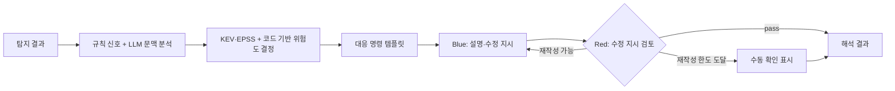

# 로컬 LLM 해석과 Red–Blue 검토

보안엔진의 탐지 결과를 한국어 설명·대응 순서·AI 코딩 도구용 수정 지시로 바꿉니다. Blue는 수정 안내를 작성하고, Red는 그 안내의 우회 가능성·기능 손상·누락을 검토합니다. **Red의 `pass`는 모델의 검토 결과이며, 코드를 실행해 공격 차단을 증명한 결과가 아닙니다.** 공격과 패치를 실제로 실행하는 기능은 [실행 검증](verify.md)에서 별도로 설명합니다.

기본 추론 대상은 자체 GPU의 vLLM입니다. 일반 서버가 소스를 수집·처리하고 GPU에 필요한 문맥을 보내며, 위협 정보 조회에는 외부 API를 사용합니다. MCP로 전달한 수정 지시도 사용자의 AI 도구로 나갑니다. 따라서 서비스 전체를 “코드나 정보가 GPU 서버 밖으로 전혀 나가지 않는다”라고 설명하지 않습니다.

## 처리 흐름



| 모드 | 동작 | 결과의 `variant` |
|---|---|---|
| `blue` | 문맥 분석 후 Blue 작성 | `C` |
| `red_blue` (기본) | Blue 작성 → Red 검토 → 필요한 경우 재작성 | `D` |

문맥 분석은 `LLM_ANALYZE_CONTEXT`로 끌 수 있습니다. 기본 재작성 한도는 2회이므로 Red–Blue는 최초 작성까지 최대 3쌍이며, 일반 서버 배포 예시는 재작성 1회로 제한합니다. 스키마·품질 재요청과 통신 재시도가 있어 실제 HTTP 호출 수는 이보다 늘 수 있습니다. 최종 Red 판정이 `pass`가 아니면 `needs_manual_review=true`입니다. 브라우저 노출 키의 권한 확인처럼 별도 사람이 확인해야 하는 사유는 Red가 통과해도 유지합니다.

| 구현 | 역할 |
|---|---|
| [context.py](../backend/app/llm/context.py), [prompts.py](../backend/app/llm/prompts.py) | 규칙 신호와 LLM으로 실행 위치, 노출 범위, 도달 가능성 등을 해석 |
| [intel.py](../backend/app/llm/intel.py) | CISA KEV·FIRST EPSS 조회와 캐시. 조회 실패·오래된 정보 여부를 구분 |
| [risk.py](../backend/app/llm/risk.py) | 문맥·위협 정보를 정책 규칙에 넣어 `act` / `attend` / `track*` / `track` 결정 |
| [remediation.py](../backend/app/llm/remediation.py) | 패키지 관리자별 대응과 Windows·macOS·Linux 명령 템플릿 생성 |
| [pipeline.py](../backend/app/llm/pipeline.py) | Blue·Red 반복, 실패·건너뜀 처리, 최종 결과 조립 |

위험도 계산 자체는 코드로 수행하지만 입력 문맥에는 모델 판단이 포함됩니다. `risk.factors`, `risk.policy`, `risk.intel`을 함께 읽어 근거와 정책 버전을 확인해야 합니다. 낮은 문맥 신뢰도나 위협 정보 조회 실패를 “취약하지 않음”으로 해석하면 안 됩니다. 문맥 분석의 일부 출력 오류는 규칙 신호로 대체하지만, LLM 연결 불가까지 정상 해석으로 숨기지는 않습니다.

## 입력과 결과

규격의 기준은 [schemas.py](../backend/app/llm/schemas.py), 엔진 입력 변환은 [engine_adapter.py](../backend/app/llm/engine_adapter.py)입니다.

- `FindingInput`은 규칙 ID·심각도·파일 위치·가린 코드 조각과 `refs`, `flags`, `fix_hint`, `status`, `change`를 받습니다. 요청 한 번에 1~50건입니다.
- 엔진 입력 변환 시 같은 생태계·패키지·lockfile의 열린 의존성 취약점을 묶을 수 있습니다. `covers`는 같은 설명에 포함된 원래 fingerprint 목록입니다. 원시 API에 여러 finding을 보냈다고 자동으로 묶이는 것은 아닙니다.
- `code_resolved`, `out_of_scope`는 LLM을 호출하지 않고 `skipped`와 이유를 반환합니다. 상태가 없는 구형 입력의 `resolved`·`unverifiable`도 건너뜁니다. `runtime_check_needed`는 키 교체 등 할 일이 남았으므로 설명 대상입니다.
- 각 결과의 `status`는 `done`, `failed`, `skipped`입니다. 실패 코드는 `LLM_UNAVAILABLE`, `LLM_BAD_OUTPUT`, `LLM_INPUT_TOO_LONG`, `LLM_ERROR`입니다. 부분 실패가 가능하므로 HTTP 성공만 보고 모두 완료됐다고 판단하지 않습니다.
- `Explanation`에는 설명·수정 단계·`ai_fix_prompt`, 문맥·위험도·대응 가이드, Red 검토 이력, 수동 확인 사유, 모델·프롬프트 버전·소요 시간이 포함됩니다. OS 입력 없이 지원하는 OS별 명령을 함께 생성합니다.

## API와 작업 수명

기본 구성(`LLM_JOBS_ENABLED=false`)의 경로는 [routers/llm.py](../backend/app/routers/llm.py)에 있습니다.

| 요청 | 용도 |
|---|---|
| `GET /api/llm/health` | vLLM 연결과 설정한 모델의 제공 여부 확인 |
| `POST /api/llm/explain/tasks` | 해석 접수, HTTP 202와 작업 ID 반환 |
| `GET /api/llm/explain/tasks/{job_id}` | `queued` → `running` → `done` / `failed` 상태와 결과 조회 |
| `POST /api/llm/explain` | 같은 입력을 동기 처리. 긴 작업은 위 작업 API 사용 권장 |

기본 작업 저장소는 메모리입니다. 재시작하면 결과가 사라지며, 완료 결과는 기본 30분·최대 50개 보관합니다. 작업 시간 제한은 대기 시간을 포함해 기본 900초입니다. 큐가 차면 429 `LLM_QUEUE_FULL`, 만료되거나 없는 ID는 404입니다. 구현은 [preview_jobs.py](../backend/app/llm/preview_jobs.py)를 참조하세요.

`LLM_JOBS_ENABLED=true`는 인증·DB·worker를 쓰는 별도 영속 작업 경로를 선택합니다. 요청 형식과 운영 조건은 [비동기 LLM 처리와 인증](async-llm.md)을 따릅니다. 두 구성을 같은 API 계약으로 취급하지 않습니다.

로컬 기본 구성에서, 저장소 루트의 Bash 터미널로 예시 입력 한 건을 접수하려면 다음과 같이 실행합니다. 백엔드는 [프로젝트 실행 방법](../README.md)에 따라 먼저 띄워야 합니다.

```bash
curl http://localhost:8000/api/llm/health
python -c 'import json; f=json.load(open("backend/tests/fixtures/findings.json", encoding="utf-8")); print(json.dumps({"mode":"blue", "findings":f[:1]}))' > llm-request.json
curl -X POST http://localhost:8000/api/llm/explain/tasks \
  -H 'Content-Type: application/json' --data-binary @llm-request.json
# 응답의 job_id로 조회
curl http://localhost:8000/api/llm/explain/tasks/JOB_ID
```

## 설정과 GPU 운영

아래는 소스 기본값이며 실제 서버의 환경 변수는 다를 수 있습니다. 기준은 [config.py](../backend/app/config.py)와 [일반 서버 설정 예시](../deploy/general-server/backend.env.example)입니다.

| 환경 변수 | 기본값 | 의미 |
|---|---|---|
| `LLM_BASE_URL` | `http://localhost:8001/v1` | OpenAI 호환 vLLM 주소 |
| `LLM_API_KEY` | 빈 값 | 배포된 vLLM에 맞춰 비밀값 설정 |
| `LLM_MODEL` | `qwen3.8-27b` | vLLM의 served model 이름 |
| `LLM_TIMEOUT_S` | `300` | 모델 HTTP 요청 제한 시간 |
| `LLM_MAX_CONCURRENCY` | `8` | 모델 요청 동시성 |
| `LLM_PARALLEL_JOBS` | `6` | 메모리 해석 작업 동시 실행 수; 모델 동시성 이하로 제한 |
| `LLM_QUEUED_JOBS` | `15` | 메모리 작업의 실행 중 + 대기 총량 |
| `LLM_RED_BLUE_MAX_REWRITES` | `2` | Red 지적 후 재작성 횟수; 배포 예시는 `1` |
| `LLM_RED_REASONING_EFFORT` | `low` | Red 추론 강도 |
| `LLM_ANALYZE_CONTEXT` / `LLM_THREAT_INTEL` | `true` / `true` | LLM 문맥 분석 / 외부 위협 정보 조회 |

[GPU 설치 스크립트](../scripts/llm/setup-gpu.sh)와 [실행 스크립트](../scripts/llm/serve.sh)는 Qwen3.8-27B AWQ INT4 체크포인트, vLLM 0.32.0을 기본으로 사용합니다. 체크포인트 `avyukth/Qwen3.8-27B-AWQ-INT4`의 revision은 `5a2ee524cbc9f3ac5df12729ecf0c4b57f311192`로 고정되어 있습니다. 모델을 바꿀 때는 저장소·revision·served name을 함께 맞춰야 합니다. 라이선스·출처는 [외부 자원](external-resources.md)을 참조하세요.

L4 24GB용 실행 기본값은 문맥 12,288토큰, 최대 시퀀스 8개, GPU 메모리 이용률 0.95입니다. vLLM은 `127.0.0.1:8001`에 바인딩하고 API 키를 요구합니다. 별도 GPU 서버를 쓸 때는 백엔드에서 접근 가능한 보호된 연결을 구성합니다. 이미 운영 중인 모델에 설치·실행 명령을 중복 적용하지 않습니다.

```bash
# 새 GPU 환경에서 운영자가 최초 설치 후 실행
bash scripts/llm/setup-gpu.sh
bash scripts/llm/serve.sh
```

`serve.sh`는 `VLLM_API_KEY`를 사용하거나 `~/.config/ymca/vllm-api-key`에 키를 생성·보관합니다. 백엔드의 `LLM_API_KEY`에는 같은 값을 비밀 설정으로 전달하며, 저장소·공개 로그·문서에 넣지 않습니다. `Python.h` 오류는 설치 스크립트의 uv 관리 Python 환경을 확인하고, FlashInfer 컴파일 오류는 실행 스크립트의 `VLLM_USE_FLASHINFER_SAMPLER=0` 설정을 확인합니다.

## 검증과 한계

입력은 데이터 구획과 길이 제한을 적용하고 비밀값을 다시 가립니다. 대응 명령의 경로·패키지·버전은 허용 문자 검사와 OS별 인용을 거칩니다. [client.py](../backend/app/llm/client.py)는 JSON 스키마·응답 모델 검증을 사용하고 품질 문제에 대해 한 번 재요청합니다. 두 번째 응답에 품질 문제가 남으면 로그를 남기고 반환할 수 있으므로 “모든 잘못된 설명이 차단된다”는 보장은 아닙니다. 지시문 주입 방어와 비밀값 가림도 완전한 차단 보증은 아닙니다.

문맥 초과는 입력 예산을 50%, 25%로 줄여 재시도합니다. 연결 오류·429·5xx는 재시도 후 실패를 반환합니다. 프롬프트·필터의 실제 기준은 [prompts.py](../backend/app/llm/prompts.py), [quality.py](../backend/app/llm/quality.py)에 있습니다.

```bash
cd backend
pip install -r requirements-dev.txt
pytest -q tests/test_llm_client.py
# 아래 두 명령은 실제 GPU를 사용합니다. LLM 연결 설정과 여유 용량 확인 후 실행합니다.
LLM_LIVE=1 pytest -m live -s tests/test_live_llm.py
python -m app.llm.check --mode blue
```

[측정 도구](../backend/app/llm/check.py)는 저장소 루트의 `outputs/llm-check-*.json`에 형식·한국어·속도 검사 결과를 저장합니다. 엔진 파일은 `--engine-input llm_input.json`으로 입력할 수 있습니다. 이 측정과 [live 테스트](../backend/tests/test_live_llm.py)는 전체 취약점의 오탐률·탐지율 또는 패치의 의미적 정확도를 입증하지 않습니다.
