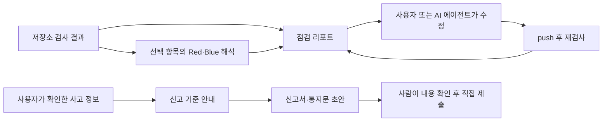

# 점검 리포트와 사고 신고 초안

검사 결과와 완료된 AI 해석으로 한국어 점검 리포트를 만들고, 사용자가 확인한 사고 정보로 신고서·통지문 초안을 만듭니다. **문서 생성은 LLM을 호출하지 않으며 외부 기관에 제출하지 않습니다.**

입출력 계약은 [schemas.py](../backend/app/reports/schemas.py), API는 [reports.py](../backend/app/routers/reports.py)에 있습니다. 이 문서는 현재 구현을 설명하며 법률 자문이나 최신 법령 검증을 대신하지 않습니다.

## 웹·MCP에서 사용하는 흐름



- 웹 검사 결과는 `/report`에서 봅니다. AI 해석을 최대 60초 기다린 뒤 엔진 결과로 먼저 리포트를 만들고, 남은 해석이 끝나면 반영합니다. 해석 전·실패 항목에도 규칙 기반 **기본 설명**을 제공합니다([웹 상태 관리](../frontend/src/components/repository-provider.tsx)).
- `/incident`에서 사고 사실을 입력하고 검사 발견을 원인 후보로 연결할 수 있습니다. 점검을 실행한 사실과 사용자가 표시한 조치·재검사 기록을 가져오지만, **취약점 발견만으로 침해 사실을 확정하지 않습니다**.
- 신고 화면은 필수 확인이 빠졌으면 초안 생성을 막거나 확인할 항목을 표시합니다. 수정한 초안은 자동으로 덮어쓰지 않으며 입력 사실이 바뀌면 이전 초안이 오래됐음을 표시합니다([화면 상태 관리](../frontend/src/components/incident-provider.tsx)).
- MCP의 `generate_report`, `incident_report`는 작업 공간에서 접근할 수 있는 검사 결과와 사용자 입력을 사용합니다. 연결과 도구 설명은 [MCP 안내](../integrations/mcp-handoff/DISTRIBUTION.md)를 따릅니다.

## API 계약

| 주소 | 요청 | 응답 |
|---|---|---|
| `POST /api/reports/plain` | `PlainReportRequest`: `scan`, `findings`, 선택적 `explain_results` | 점검·완료 리포트 |
| `POST /api/reports/assess` | `IncidentInput` 자체 | `AssessResponse` JSON: 신고 종류별 기준 해당 여부·사유·기한 |
| `POST /api/reports/incident-24h` | `FilingRequest`: `incident`, 선택적 `findings` | 침해사고 신고서 초안·이용자 통지 안내 |
| `POST /api/reports/privacy-72h` | `FilingRequest`: `incident`, 선택적 `findings` | 개인정보 유출신고서 초안·정보주체 통지문 |

`plain`, `incident-24h`, `privacy-72h`는 `?format=json|markdown|html`을 지원합니다. 기본은 `Report` JSON이고, Markdown은 복사·다운로드, HTML은 브라우저 표시·인쇄용입니다. **`assess`는 형식 선택 없이 JSON만 반환합니다.** HTML을 PDF로 저장하는 작업은 브라우저 인쇄 기능입니다.

리포트 API는 요청 본문을 문서로 변환합니다. 검사 ID만 받아 DB에서 조회하거나 리포트를 자동 보관하는 API가 아닙니다. 검사 결과 저장은 [scan-persistence.md](scan-persistence.md)의 별도 기능이고, 신고 화면의 입력·편집 상태는 컴포넌트 메모리에 있습니다. 보관할 초안은 내려받아야 합니다.

### 점검 리포트 예시

다음을 `plain-input.json`으로 저장합니다. 아래는 설명을 위한 가상 입력이며 실제 검사 증거가 아닙니다.

```json
{
  "scan": {
    "site_name": "예제 서비스",
    "repo": "example/project",
    "scanned_at": "2026-11-01T10:00:00+09:00",
    "not_checked": []
  },
  "findings": [{
    "fingerprint": "example-config-1",
    "tool": "config",
    "category": "config",
    "rule_id": "config/lockfile-missing",
    "title": "lockfile 없음",
    "severity": "low",
    "file_path": "package.json",
    "status": "code_issue"
  }],
  "explain_results": []
}
```

```bash
curl --fail-with-body -X POST 'http://localhost:8000/api/reports/plain?format=html' \
  -H 'Content-Type: application/json' \
  --data-binary @plain-input.json -o report.html
```

실제 웹 검사에서는 완료된 `/api/scans/{job_id}` 응답의 `report_scan`을 `scan`에, `findings`를 같은 이름의 필드에 넣습니다. AI 비동기 작업이 완료되면 그 응답의 `result.results`를 `explain_results`에 넣습니다. 원본 스캐너 JSON을 직접 전달하지 않습니다([검사 어댑터](../backend/app/llm/engine_adapter.py), [LLM 계약](llm.md)).

### 점검 결과를 해석하는 기준

| 항목 | 현재 동작 |
|---|---|
| AI 해석 없음 | 분류·CWE·패키지·버전·한국어 규칙 설명으로 기본 설명 제공. 우선순위는 심각도로 대체 |
| AI 해석 있음 | 완료된 해석만 사용. 같은 패키지의 묶음(`covers`)은 카드 하나로 표시 |
| 순서 | 우선순위 → 심각도. 오탐 의심 항목은 뒤로 보내고 즉시 조치 목록에서 제외 |
| 해결 | 엔진의 `code_resolved` 등 해결 상태를 따름. AI 설명만으로 해결 처리하지 않음 |
| 검사 누락 | `not_checked`, `out_of_scope`, 확인 불가 항목이 있으면 발견 0건이어도 완료로 표시하지 않음 |
| 완료 | 열린 문제·재검사 필요·검사 누락이 모두 없는 입력. 해당 검사 범위의 결과이며 서비스 전체의 안전 보장이 아님 |
| 검토 배지 | 코드상 `공격 검증 통과`는 Red의 모델 검토 결과. 샌드박스에서 공격을 실행한 결과는 별도 [실검증](verify.md)으로 확인 |
| 해결 타이머 | `detected_at`이 있을 때만 서비스 기준 72시간을 계산. 완료 시 `resolved_at` 또는 `scanned_at`에서 정지. 서버 알림·작업 스케줄러가 아님 |

생성 시각·남은 시간은 API 호출 시각을 반영하므로 같은 입력으로 다시 만들어도 시간 표시는 달라질 수 있습니다. 원문 코드 조각은 리포트에 넣지 않고 탐지 제목·설명 등에 알려진 비밀값 패턴 마스킹을 적용합니다. 임의의 모든 비밀정보를 탐지한다는 보장은 없으므로 공유 전에 내용을 확인합니다.

## 신고 초안의 입력과 경계

`assess`에는 `IncidentInput` 자체를, 신고 초안에는 `{"incident": {...}, "findings": [...]}`를 보냅니다. `discovered_at`은 필수이며 시각에는 `+09:00` 같은 시간대가 있어야 합니다. 시간대가 없는 입력은 422입니다.

- 모르는 사실을 피해 발생·미발생으로 바꿔 입력하지 않습니다. 웹은 확인하지 않은 기본값을 사실처럼 제출하지 않도록 추가 확인을 요구합니다.
- `related_fingerprints`에 연결한 발견은 원인 후보에 활용할 수 있지만 실제 공격·유출의 증거를 대신하지 않습니다.
- 빈 필수 칸은 출력의 `missing`, 서비스가 제안한 내용은 `auto: true`로 구분합니다. 사용자 입력의 정확성은 API가 검증할 수 없습니다.
- 코드의 신고 기준·기한 계산은 [`filing.py`](../backend/app/reports/filing.py), 안내 문구·기한 상수·제출처는 [`legal.py`](../backend/app/reports/legal.py)에 모여 있습니다. 리포트의 서비스 해결 타이머와 신고 기한은 별개입니다.
- 실제 적용 대상·신고/통지 의무·기한은 현재 공식 안내와 사건 사실을 확인해야 합니다. 코드에 저장된 문구를 최신 법령 확인 결과로 취급하지 않습니다. 관련 금융 분야 등 모든 신고 체계를 지원하지 않습니다.

현재 공식 안내를 확인할 출발점은 [KISA 침해사고 신고 안내](https://www.boho.or.kr/kr/subPage.do?menuNo=205033)와 [개인정보보호위원회 유출신고 안내](https://pipc.go.kr/np/default/page.do?mCode=D030040000)입니다. 이 문서 정리에서는 법률 규칙을 새로 검증하거나 변경하지 않았습니다. 법령·서식 갱신 시에는 `legal.py`, `filing.py`, 경계값 테스트를 함께 검토합니다.

## 검증

백엔드 개발 의존성을 설치한 환경에서 실행합니다.

```bash
cd backend
python -m pytest -q tests/test_reports.py
```

기본 설명, 해석 묶음, 완료/누락 판정, 기한·기준 경계값, 비밀값 마스킹, HTML 이스케이프, 출력 형식과 입력 거부를 검사합니다. [프론트 테스트](../frontend/tests/incident.test.mjs)는 사용자 사실 확인·초안 조건을, [상태 통합 검사](../frontend/scripts/verify-incident-provider.mjs)는 편집본 유지와 오래된 응답 처리를 확인합니다. 테스트 통과는 신고 내용의 사실성이나 법적 적합성을 보증하지 않습니다.
