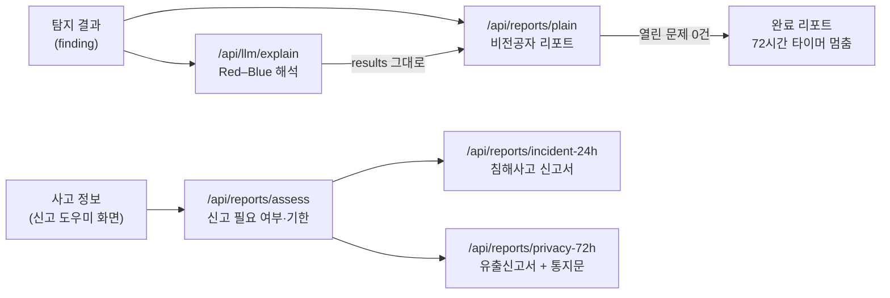

# 리포트와 신고서 초안 (④ 대응 안내 · 72시간 산출물)

탐지 결과와 Red–Blue 해석을 **비전공자가 읽는 점검 리포트**로 바꾸고, 사고가 의심되면 **KISA 침해사고 신고(24시간)**와 **개인정보 유출 신고(72시간)** 초안을 만듭니다.



- **LLM을 다시 부르지 않습니다.** 리포트는 이미 검증된 해석을 다시 배치만 하고, 신고서는 법이 정한 항목에 사용자 입력을 채웁니다. 법 문장을 모델이 지어내면 안 되기 때문입니다. GPU가 꺼져 있어도 동작합니다.
- **빈 필수 칸은 지어내지 않습니다.** `missing`에 모아 "제출 전에 채울 칸"으로 보여 줍니다. 서비스가 대신 제안한 값(원인 후보, 정보주체 피해 최소화 방법 등)은 `auto: true`로 표시합니다.
- **비밀값은 밖으로 나가지 않습니다.** 탐지 결과의 제목·설명은 LLM 모듈의 `redact_secrets`로 한 번 더 가리고, 코드 조각(`snippet`)은 리포트에 넣지 않습니다.

## API

모든 리포트 주소는 `?format=json|markdown|html`을 받습니다.

| 형식 | 용도 |
|---|---|
| `json` (기본) | 대시보드 화면. 같은 `Report` 구조(섹션·칸·카드·배지)라 화면 컴포넌트 하나로 세 리포트를 그립니다 |
| `markdown` | 이슈·메일·노션에 붙여 넣기 |
| `html` | 한 장짜리 문서. 브라우저에서 인쇄하면 A4 PDF가 되어 신고서 첨부·보관에 씁니다 |

| 주소 | 하는 일 |
|---|---|
| `POST /api/reports/plain` | 비전공자용 점검 리포트. 열린 문제가 없으면 완료 리포트 |
| `POST /api/reports/assess` | 사고 정보로 어떤 신고가 필요한지, 기한이 언제인지 |
| `POST /api/reports/incident-24h` | KISA 침해사고 신고서 초안 |
| `POST /api/reports/privacy-72h` | 개인정보 유출신고서 초안 + 정보주체 통지문 |

### 비전공자 리포트

```bash
curl -X POST 'http://localhost:8000/api/reports/plain?format=html' \
  -H 'Content-Type: application/json' \
  -d '{
    "scan": {"site_name": "데모 쇼핑몰", "site_url": "https://demo.shop",
             "scanned_at": "2026-10-31T09:00:00+09:00", "detected_at": "2026-10-30T09:00:00+09:00"},
    "findings": [ ...finding... ],
    "explain_results": [ .../api/llm/explain 응답의 results 그대로... ]
  }' > report.html
```

읽는 순서: 한눈에 보기 → 지금 바로 할 일 → 고칠 것 자세히 → 이번에 검사하지 못한 영역 → 다시 검사·해결된 것 → 용어 풀이 → 다음 단계

보안엔진(#21) 결과를 그대로 쓸 때: `findings`는 `engine_adapter.from_engine_payload(llm_input)`, `scan.not_checked`는 엔진 LLM 입력의 `not_checked`를 그대로 넣으면 됩니다.

| 규칙 | 내용 |
|---|---|
| 상태 | `위험`(지금 바로 고칠 것 있음), `주의`, `다시 검사 필요`, `완료` |
| 검사하지 못한 영역 (#28) | `scan.not_checked`(도구 실패·lockfile 없음 등)를 따로 보여 줍니다. 이런 영역이 있으면 문제가 0건이어도 `완료`가 아니라 `다시 검사 필요`이고 "안전" 문구를 쓰지 않습니다. 도구 원문의 서버 경로는 지웁니다 |
| 패키지 묶음 (#27) | 같은 패키지의 의존성 취약점을 한 번에 설명한 결과(`covers`)는 카드 하나로 묶고, 함께 해결되는 건수·CVE를 붙입니다. 대표 심각도는 묶음 중 가장 높은 것 |
| 순서 | 우선순위(`now`→`soon`→`later`) → 심각도. 오탐 의심은 맨 뒤로 보내고 '지금 바로 할 일'에서 뺍니다 |
| 해석이 없는 건 | 심각도로 우선순위를 정하고 "설명 준비 중"으로 보여 줍니다 (LLM 실패·대기 중에도 리포트는 나옴) |
| 검증 배지 | Red 통과 `공격 검증 통과`, 끝까지 못 통과 `사람 확인 필요`, Blue만(C) 배지 없음 |
| 해결·재검사 | LLM의 건너뛰기 규칙과 같습니다. `code_resolved`는 해결, `out_of_scope`·`change: unverifiable`은 다시 검사 필요 |
| 72시간 타이머 | `detected_at`부터 72시간. 열린 문제가 0건이면 `resolved_at`(없으면 `scanned_at`)에 멈춥니다 |
| 용어 풀이 | 열린 문제의 CWE·CVE 번호와 제목 단어로 골라 붙입니다. 번호는 정확히 일치할 때만 (CWE-79 ≠ CWE-798) |
| 신고 안내 | 비밀키 노출이 열려 있으면 "이미 쓰였을 수 있음 → 접속 기록 확인 → 신고 도우미"를 다음 단계에 붙입니다 |

### 신고 도우미

사고 정보(`IncidentInput`) 한 덩어리로 세 주소를 모두 부릅니다. 모르는 칸은 비워 두세요.

```json
{
  "organization": {"name": "데모커머스", "department": "운영팀", "contact_name": "홍길동", "contact_phone": "02-000-0000"},
  "discovered_at": "2026-10-31T08:00:00+09:00",
  "occurred_at": null,
  "incident_types": ["hacking"],
  "summary": "유출된 관리자 키로 고객 표 전체가 조회되었습니다.",
  "actions_taken": [{"at": "2026-10-31T08:30:00+09:00", "action": "키 폐기 후 재발급"}],
  "related_fingerprints": ["demo-secret-supabase-service-role"],
  "personal_info": {"leaked": "confirmed", "affected_count": 1520, "count_is_estimate": true,
                    "items": ["이름", "이메일", "비밀번호(해시)"], "external_unauthorized_access": true}
}
```

- 신고서 주소는 `{"incident": {...}, "findings": [...]}`를 받습니다. `related_fingerprints`의 탐지 결과가 있으면 원인 칸이 비었을 때 원인 후보로 제안합니다.
- **시각은 반드시 시간대를 붙입니다**(`+09:00`). 시간대가 없으면 서버마다 다르게 해석해 기한이 틀어지므로 422로 거부합니다.
- 화면 흐름 제안: `assess`로 필요한 신고와 남은 시간을 먼저 보여 주고, 필요한 신고서만 열게 합니다.

## 근거 (마지막 확인 2026-10-31)

기한·항목·제출처는 [`backend/app/reports/legal.py`](../backend/app/reports/legal.py) 한 곳에 있습니다. 법이 바뀌면 그 파일과 이 표만 고칩니다.

| 신고 | 기한 | 신고 사항 | 제출처 | 출처 |
|---|---|---|---|---|
| 침해사고 (정보통신망법 제48조의3·시행령, 2024-08-14 시행) | 알게 된 때부터 24시간. 추가 확인 사항은 확인한 때부터 24시간 이내 보완 신고 | ① 발생 일시·원인·피해 내용 ② 조치 사항 등 대응 현황 ③ 대응 담당 부서·연락처 | KISA 보호나라(boho.or.kr), 118. 서면·전자우편·전화·홈페이지 | [KISA 보호나라 침해사고 신고 안내](https://www.boho.or.kr/kr/subPage.do?menuNo=205033), [김·장 법률사무소](https://www.kimchang.com/ko/insights/detail.kc?sch_section=4&idx=30389), [보안뉴스](https://m.boannews.com/html/detail.html?idx=132012) |
| 개인정보 유출 (개인정보 보호법 제34조·시행령 제40조) | 알게 된 때부터 72시간. ① 1천명 이상 ② 민감·고유식별정보 ③ 외부 불법 접근 중 하나 | 통지 여부, 유출 항목·규모, 시점·경위, 피해 최소화 조치·결과, 정보주체 피해 최소화 방법·구제절차, 담당부서·담당자·연락처 | brss.pipc.go.kr (접수 KISA) | [개인정보보호위원회](https://pipc.go.kr/np/default/page.do?mCode=D030040000), [시행령 제40조](https://itwiki.kr/w/%EA%B0%9C%EC%9D%B8%EC%A0%95%EB%B3%B4_%EB%B3%B4%ED%98%B8%EB%B2%95_%EC%8B%9C%ED%96%89%EB%A0%B9_%EC%A0%9C40%EC%A1%B0) |
| 정보주체 통지 (개인정보 보호법 제34조·시행령 제39조, 2026-09-11 시행 개정) | 신고 대상과 상관없이 알게 된 때부터 72시간. '유출등'은 분실·도난·유출·위조·변조·훼손. 확인 전이라도 ① 불법 접근은 확인됐는데 정보주체 특정이 어렵거나 ② 일부 유출이 확인돼 다른 정보도 유출됐을 수 있으면 '유출등 가능성' 통지(시행령 제39조의2·제39조의3, 72시간) | 유출(가능성) 항목, 시점·경위, 피해 최소화 방법, 담당부서·연락처 | 정보주체에게 서면 등. 연락처를 모르면 홈페이지 30일 이상 게시 | [법률신문(광장)](https://www.lawtimes.co.kr/news/articleView.html?idxno=226491), [신구조문 대조표](https://datalaw.kr/posts/pipa-2026-amendment-comparison/), [개정 시행령 정리](https://pieinc.co.kr/guide/personal-info-protection-act-amendment-2026-09) |
| 침해사고 이용자 통지 (정보통신망법·시행령 제58조의9, 2026-10-01 시행) | 지체 없이. 이용자 정보 유출·변조·훼손 또는 그 가능성, 2시간 이상 서비스 중단 등 | 발생 시각·원인·피해, 대응 조치, 이용자 피해 최소화 방법, 피해 구제, 문의처 | 이용자에게 서면·전화·전자우편·문자 등. 연락처를 모르면 홈페이지 30일 이상 게시 | [법률신문(태평양)](https://www.lawtimes.co.kr/news/articleView.html?idxno=227668) |

- 개인정보 과태료(시행령 기준): 유출 통지·가능성 통지·신고 누락 각각 1회 900만·2회 1,800만·3회 이상 3,000만 원(개인정보 보호법 시행령 별표 2, 2026-09-11). 출처: [개정 시행령 정리](https://pieinc.co.kr/guide/personal-info-protection-act-amendment-2026-09)
- 2026-10-01 시행 개정 법률은 24시간 기한을 법률 본문에 넣었습니다([IT위키 제48조의3](https://itwiki.kr/w/%EC%A0%95%EB%B3%B4%ED%86%B5%EC%8B%A0%EB%A7%9D%EB%B2%95_%EC%A0%9C48%EC%A1%B0%EC%9D%983)).
- 침해사고를 24시간 안에 신고하지 않거나 늦게 신고하면 제76조에 따라 **5천만원 이하** 과태료입니다([KISA 보호나라](https://www.boho.or.kr/kr/subPage.do?menuNo=205033), 2026-10-31 확인). 예전 시행령 기준의 위반 횟수별 금액(750만·1,500만·3,000만 원)은 지우고, 공식 안내에 있는 상한만 적습니다.
- 2026-09-11 시행 개정 개인정보 보호법·시행령: 유출 가능성 통지 신설, 위조·변조·훼손(랜섬웨어 등)도 유출신고·통지 대상, 유출통지 항목에 분쟁조정 신청·손해배상 청구 방법 추가([개인정보보호위원회 보도자료 2026-09-10](https://m.korea.kr/briefing/pressReleaseView.do?newsId=156781056)). 리포트는 이를 안내하고 통지문에 분쟁조정·손해배상 줄을 넣습니다. 유출이 '의심'이면 가능성 통지의 두 경우(시행령 제39조의2)와 72시간 기한을 안내하지만, 어느 경우에 해당하는지는 자동 판정하지 않습니다.
- 유출 경로를 확인하고 회수·삭제해 피해 가능성이 현저히 낮으면 개인정보 유출은 신고하지 않을 수 있습니다(`recovered_low_risk`). 신고 대상이 아니어도 **정보주체 통지는 필요**하므로 리포트가 계속 안내합니다.
- 유출 항목이나 시점·경위를 모르면 확인된 내용으로 먼저 신고하고 추가 확인 즉시 신고합니다(시행령 제40조 제2항). 발생 시점만 모르면 칸을 "확인 중"으로 채워 먼저 신고할 수 있게 했습니다.

## 알려진 한계

- **법률 자문이 아닙니다.** 모든 신고서에 안내 문구가 붙습니다. 공식 서식(별지)이 바뀌면 칸 이름이 다를 수 있으니 제출처에서 확인합니다.
- 금융회사·신용정보회사의 개인신용정보 유출은 금융감독원 소관이라 다루지 않습니다.
- 정보통신서비스 제공자 해당 여부는 판단하지 않고 "영리 목적 웹사이트·앱 운영자는 의무"로 안내합니다. 우리 대상(홈페이지를 운영하는 중소기업)은 대부분 해당합니다.
- 아직 DB에 저장하지 않습니다. `finding`·`explanation` 테이블(#7)이 생기면 라우터에서 DB를 읽어 같은 입력 모양으로 넘기면 되고, 리포트 코드는 바꿀 필요가 없습니다.

## 테스트

```bash
cd backend
pytest -q tests/test_reports.py
```

기한 경계(23시간 59분 30초는 기한 안, 24시간 1초는 지남), 신고 기준 경계(999명/1,000명, 민감·고유식별·외부 접근, 회수 예외), 비밀값 가림, HTML 이스케이프, 세 가지 출력 형식, 잘못된 입력(시간대 없는 시각 등) 거부를 검사합니다.
