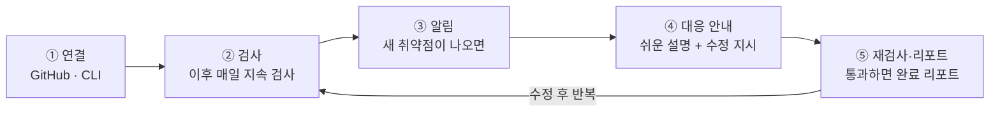
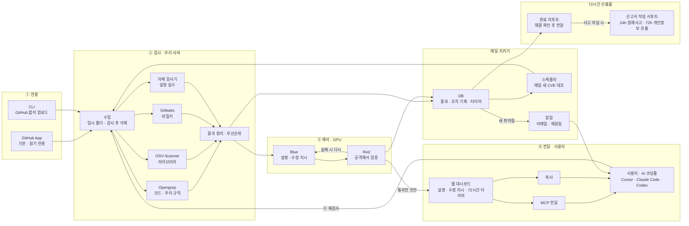

# 72hours 시스템 플로우

취약점 발견부터 해결, 리포트 전달까지 72시간 안에 끝내는 웹사이트 보안 서비스입니다.

> 같은 내용을 그림으로 보려면 [`system-flow.html`](system-flow.html)을 내려받아 브라우저로 여세요.

## 1. 사용자 흐름

- 핵심은 ④입니다. 비개발자도 이해하고 바로 고칠 수 있게 안내합니다.
- **72시간 타이머**: ②에서 취약점이 발견된 순간(0h) 시작하고, ⑤에서 재검사를 통과해 완료 리포트가 전달되면(72h) 멈춥니다.

## 2. 시스템 구성

- 연결 방식의 확장 후보는 CI(GitHub Actions에서 CLI 실행)와 MCP 모드입니다.
- 소스는 검사가 끝나면 지우고, 결과와 의존성 목록만 남깁니다.

## 3. 핵심 네 가지

| 구분 | 내용 |
|---|---|
| **찾기** · 검증된 도구 + 우리 규칙 | 코드, 라이브러리, 비밀키(과거 커밋 포함), 웹셸, 설정 실수를 찾습니다. 모두 유료 서비스에 써도 되는 라이선스입니다. |
| **고치기** · GPU LLM Red–Blue | Blue가 쉬운 설명과 수정 지시를 쓰고 Red가 공격해 봅니다. 통과한 수정만 대시보드와 MCP로 코딩툴에 전달합니다. |
| **72시간** · 해결 + 리포트, 사고 시 신고 서포트 | 발견 순간 타이머가 시작되고 완료 리포트 전달로 멈춥니다. 사고가 의심되면 24시간·72시간 신고서 작성을 돕습니다. |
| **증명** · GPU 효과를 숫자로 | 같은 취약점을 스캐너 원문, GPU 없는 LLM, GPU LLM, Red–Blue 추가로 처리해 조치 성공률과 이해도를 비교합니다. |

## 4. 팀과 확정할 것

- [ ] 공통 JSON 규격과 검사 실행 방식 (오늘 밤, 전원)
- [ ] 우리 규칙 목록 (장양환) · GPU 모델과 Red–Blue 횟수 (김건우)
- [ ] 신고서 작성 서포트를 MVP에 넣을지 (전원)
- [ ] 신고서 서식과 신고 대상 기준 원문 확인 (박기태)
