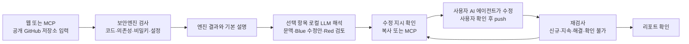
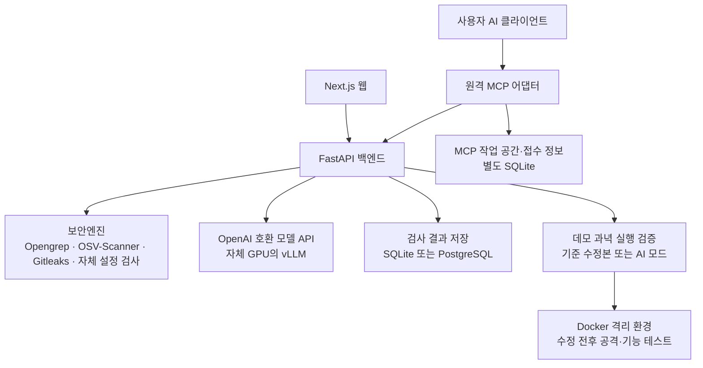

# 72hours 시스템 흐름과 지원 범위

72hours는 AI 코딩 도구로 만든 서비스의 위험을 찾아, 사용자가 이해하고 수정한 뒤 다시 확인하도록 돕습니다. 웹과 원격 MCP로 이용하며, 사용자의 PC에 모델이나 서버를 설치할 필요는 없습니다. 직접 운영할 때의 설치 절차는 [프로젝트 README](../README.md)를 따릅니다.

## 사용자 흐름

- **입력:** 공개 GitHub 저장소의 기본 브랜치입니다. 공개 API의 허용 소유자 목록은 운영 설정으로 관리합니다. 배포된 임의 웹사이트를 공격하는 서비스가 아닙니다.
- **결과:** 검사한 커밋, 도구별 실행 상태와 탐지 근거를 함께 표시합니다. 검사 오류·미실행을 취약점 해결로 간주하지 않습니다.
- **AI 해석:** 웹은 주요 항목을 분석하고, 긴 해석을 모두 기다리지 않고 엔진 결과부터 표시합니다. 기본 설명과 AI 해석은 구분합니다. 처리 시간과 동시성은 모델·운영 설정에 따라 달라집니다.
- **수정:** MCP는 수정 지시를 전달합니다. 연결된 코딩 에이전트가 사용자 권한으로 코드를 고치며, 서버가 사용자 PC의 파일을 직접 수정하지 않습니다.
- **재검사:** 기본 브랜치에 push된 결과를 이전 검사와 비교합니다. 로컬 수정만으로 해결 표시가 생기지 않으며, 비밀키는 코드 삭제와 폐기·재발급을 구분합니다.

## 구성과 역할

| 구성 | 직접 처리하는 일 | 상세 문서 |
|---|---|---|
| 보안엔진 | 외부 검사기 실행, 자체 규칙·설정 검사, 정규화·지문·재검사 판정 | [엔진](../security_engine/README.md) |
| LLM 파이프라인 | 문맥 분석, Blue 수정 설명, Red 검토·재작성 제어 | [LLM](llm.md) |
| 결정론적 처리 | SSVC 결정표 적용, OS별 명령 템플릿, 출력 검증·비밀값 마스킹 | [LLM 역할 분리](llm.md) |
| MCP | 작업 공간 관리, 검사·해석·수정 지시·재검사·리포트 API 연결 | [연결·도구 사용법](../integrations/mcp-handoff/DISTRIBUTION.md) |
| 리포트 | 엔진/해석 결과 정리, 사용자 확인 사실을 바탕으로 사고 신고 초안 생성 | [리포트](reports.md) |
| 실행 검증 | 데모 과녁에서 공격 성공 여부와 기능 유지 비교 | [범위·격리·결과 확인](verify.md) |

외부 스캐너·기초모델·SSVC 방법론을 새로 개발한 것은 아닙니다. 사용한 자원과 출처는 [외부 자원 내역](external-resources.md)에 기록합니다.

## 검증의 의미

1. **탐지:** 보안엔진이 해당 규칙·버전에 맞는 위험을 발견했다는 뜻입니다. 미탐이나 오탐이 없음을 보장하지 않습니다.
2. **Red 검토:** 모델이 수정 제안을 검토한 결과입니다. 실제 공격을 실행해 차단을 확인한 결과와 다릅니다.
3. **재검사:** 같은 저장소의 변경된 커밋을 엔진으로 다시 확인합니다. 도구 실행 범위가 달라지면 확인 불가로 남길 수 있습니다.
4. **실행 검증:** 현재 공개 API의 대상은 자체 데모 과녁입니다. 기준 수정본 모드와 AI 생성 공격·패치 모드를 구분하며, 개별 결과의 환경·격리 상태·공격 및 기능 테스트를 함께 확인합니다. Docker가 없는 기준 수정본 모드의 로컬 실행을 격리 검증으로 소개하지 않습니다.

## 데이터와 운영 경계

- 검사 소스는 임시 clone 경로에서 읽고 정리합니다. 마스킹한 결과·코드 조각이 리포트나 해석에 포함될 수 있습니다.
- 모델 추론은 설정한 모델 서버에서 수행합니다. 사용자 AI 클라이언트에 전달한 내용의 처리는 그 클라이언트의 정책을 따르므로 전체 흐름이 오프라인이라는 뜻은 아닙니다.
- 공개 데모 작업과 Supabase 인증·DB 기반 비동기 작업은 별도 경로입니다. [DB 구조](db-erd.md)와 [비동기 활성화](async-llm.md)를 구분해 읽습니다.
- 검사 결과 저장, 메모리 LLM/실검증 결과, MCP 작업 DB의 수명은 서로 다릅니다. 서버 재시작 시 모든 결과가 유지된다고 가정하지 않습니다.
- 일반 서버 자동배포와 GPU 모델 운영은 분리합니다. [자동배포 문서](../deploy/general-server/auto-deploy/README.md)에서 적용 대상·중단·복구 범위를 확인합니다.

지원 대상과 환경별 제약은 [지원 범위와 제한](limitations.md)에 정리합니다. 72hours라는 이름은 모든 취약점을 72시간 안에 해결한다는 보장이 아닙니다.
